# CVKI — M10.1 Architecture Audit & Roadmap Design
**Civic Vision & Knowledge Intelligence (CVKI)**  
*Document Version: 1.0.0 · Milestone: M10.1 · Date: October 2026*  
*Status: ARCHITECTURE AUDIT & ROADMAP SPECIFICATION (READ-ONLY BASELINE)*

---

## 1. Executive Summary

Milestone 9 (M9) established a fully validated, model-independent, explainable multimodal civic intelligence foundation. Across submodules M9.1 through M9.7, CVKI introduced:
- Standardized multimodal SPI contracts ([`contracts.py`](file:///c:/Users/sushm/OneDrive/Desktop/CIVKI/backend/app/services/multimodal/contracts.py), [`spi.py`](file:///c:/Users/sushm/OneDrive/Desktop/CIVKI/backend/app/services/multimodal/spi.py)).
- Heuristic cross-modal evidence consistency checking ([`cross_modal_consistency.py`](file:///c:/Users/sushm/OneDrive/Desktop/CIVKI/backend/app/services/multimodal/cross_modal_consistency.py)).
- Active ambiguity resolution without chatbot hallucinations ([`active_clarification.py`](file:///c:/Users/sushm/OneDrive/Desktop/CIVKI/backend/app/services/multimodal/active_clarification.py)).
- Rule-based Indic vernacular normalization covering 5 linguistic variants ([`vernacular_normalizer.py`](file:///c:/Users/sushm/OneDrive/Desktop/CIVKI/backend/app/services/multimodal/vernacular_normalizer.py)).
- Bounded before/after visual resolution auditing ([`visual_resolution_auditor.py`](file:///c:/Users/sushm/OneDrive/Desktop/CIVKI/backend/app/services/multimodal/visual_resolution_auditor.py)).
- Full bi-directional evidence provenance and knowledge-graph projection ([`provenance_kg_integrator.py`](file:///c:/Users/sushm/OneDrive/Desktop/CIVKI/backend/app/services/multimodal/provenance_kg_integrator.py)).
- 100% test pass rate across 153 M9 test assertions and 76 core regression suites.

The objective of **M10.1** is to perform a comprehensive architectural audit of the entire codebase—spanning backend services, API routes, database schemas, frontend clients, security perimeters, and testing suites—and design an evidence-based roadmap for **Milestone 10**.

### Core Audit Finding
CVKI has achieved world-class capabilities in **evidence capture, computer vision detection, multimodal consistency, official authority mapping, external contextualization, and provenance-backed knowledge graphing**. However, the system currently stops at **passive intelligence presentation**. When an authority officer, municipal engineer, or field inspector opens a complaint case, they are presented with disparate raw signals (P1–P4 priority score, raw detection bounding boxes, weather context, and graph nodes), but **no evidence-grounded operational decision support, no structured action playbooks, no SLA breach trajectory forecasting, and no field inspection protocol**. Furthermore, M9's multimodal engines exist exclusively as internal backend Python services without REST API routes or frontend user interfaces.

### Strategic Recommendation for M10
**Theme: "Evidence-Aware Civic Decision Support & Operational Action Intelligence (Human-in-the-Loop Triage, Playbook Recommendation, and Field Inspection Guidance)"**  
M10 will transform CVKI from an evidence-recording pipeline into an actionable, human-in-the-loop civic operational intelligence platform without retraining models, without external LLM dependencies, without claiming physical ground truth, and strictly respecting the post-M12 supercomputing CV boundary.

---

## 2. Current Architecture & Dependency Graph

### 2.1 Architectural Overview
The CVKI backend is structured as a modular FastAPI asynchronous service backed by MongoDB persistence, with an in-memory/caching layer for external context and graph structures. The frontend is a React 18 single-page application utilizing Lucide icons and Leaflet geospatial maps.

```mermaid
flowchart TD
    subgraph ClientLayer ["Client & Ingestion Layer"]
        CitizenUI["Citizen Web App (React)"]
        AuthorityUI["Authority Portal (React)"]
        AdminUI["Admin Dashboard (React)"]
    end

    subgraph APILayer ["FastAPI Routing Layer (backend/app/api/v1/)"]
        AuthRouter["auth.py (JWT + CSRF)"]
        DetectionRouter["detection.py"]
        ComplaintRouter["complaint.py (Cases, Drafts, Guidance)"]
        GeoRouter["geospatial.py & location.py"]
        GovRouter["government_integration.py (M7)"]
        KGRouter["knowledge_graph.py (M6.5)"]
        ProvRouter["provenance.py (M6.4)"]
        AdminRouter["admin.py (M4)"]
    end

    subgraph IntelligenceCore ["Core Civic Intelligence Engines"]
        CVRuntime["M8 CV Runtime (cv_runtime.py)"]
        M113["M1.13 YOLOv8n Frozen Provider"]
        NLPEngine["M3.6 NLP & Entity Extractor"]
        DupEngine["M3.7 Duplicate Detection Engine"]
        PriorityEngine["M3.8 Priority & Risk Scoring"]
        RecurrenceEngine["M5.2 Recurrence & Hotspot Engine"]
        LiveAuth["M6.1 Live Authority Resolver"]
        ExternalData["M6.3 External Civic Data (Weather/Traffic/Alerts)"]
    end

    subgraph MultimodalPipeline ["M9 Multimodal Intelligence Layer (app/services/multimodal/)"]
        MMSPI["M9.1 Multimodal SPI & Contracts"]
        ConsistencyEngine["M9.2 Cross-Modal Consistency Engine"]
        ClarificationEngine["M9.3 Active Clarification Resolver"]
        VernacularNormalizer["M9.4 Multilingual Vernacular Normalizer"]
        VisualAuditor["M9.5 Before/After Visual Resolution Auditor"]
        MMKGIntegrator["M9.6 Multimodal Provenance & KG Integrator"]
    end

    subgraph TrustAndGraphLayer ["Epistemic Trust, Provenance & Graph Layer"]
        ProvenanceEngine["M6.4 Evidence Provenance Engine"]
        KnowledgeGraphService["M6.5 Civic Knowledge Graph Service"]
        GovAdapter["M7 Government Portal Adapters"]
        EscalationService["M7.5 Escalation Engine"]
        ResolutionVerify["M7.6 Citizen Resolution Verification"]
    end

    subgraph PersistenceLayer ["Persistence & Storage"]
        MongoDB[("MongoDB Database\n(Cases, Audits, Users, References)")]
        LocalCache["In-Memory Caches\n(Geo, Authority, External Context)"]
        FrozenWeights[("Frozen Model Weights\n(m1_13/weights/best.pt)")]
    end

    %% Wiring
    CitizenUI --> DetectionRouter
    CitizenUI --> ComplaintRouter
    CitizenUI --> AuthRouter
    AuthorityUI --> AdminRouter
    AuthorityUI --> GovRouter
    AuthorityUI --> KGRouter
    AdminUI --> AdminRouter
    AdminUI --> ProvRouter

    DetectionRouter --> CVRuntime
    CVRuntime --> M113
    M113 --> FrozenWeights

    ComplaintRouter --> NLPEngine
    ComplaintRouter --> DupEngine
    ComplaintRouter --> PriorityEngine
    ComplaintRouter --> RecurrenceEngine
    ComplaintRouter --> LiveAuth
    ComplaintRouter --> MongoDB

    ExternalData --> LocalCache
    LiveAuth --> LocalCache

    MultimodalPipeline --> MMSPI
    MMSPI --> ConsistencyEngine
    ConsistencyEngine --> ClarificationEngine
    ConsistencyEngine --> VernacularNormalizer
    MMSPI --> VisualAuditor
    MultimodalPipeline --> MMKGIntegrator

    MMKGIntegrator --> ProvenanceEngine
    MMKGIntegrator --> KnowledgeGraphService

    GovRouter --> GovAdapter
    GovRouter --> EscalationService
    GovRouter --> ResolutionVerify

    ProvenanceEngine --> MongoDB
    KnowledgeGraphService --> LocalCache
```



### 2.2 System Coupling Analysis
1. **Frontend-Backend Coupling**: The React frontend interacts with 14 distinct API service files (`frontend/src/services/*.js`). However, `App.jsx` has grown into a 4,368-line monolithic component holding inline views, modals, and local state machines for all user roles.
2. **Model-Runtime Decoupling**: Fully achieved in M8. The CV inference pipeline interacts solely via `StandardDetectionResult` and `CVProvider` SPI, isolating YOLOv8/PyTorch dependencies from application logic.
3. **Multimodal Service Isolation**: M9 submodules are fully decoupled and communicate via immutable Pydantic schemas. However, they lack an HTTP gateway router in `backend/app/main.py`.
4. **Knowledge Graph & Provenance Isolation**: M6.4 and M6.5 operate as append-only evidentiary graphs with deterministic canonical keying. They preserve epistemic boundaries: models emit *claims*, citizens emit *assertions*, sensors emit *measurements*, and government portals emit *official statuses*.

---

## 3. M1–M9 Capability Matrix

| Module | Core Capability | Implementation Location | Evidence Artifacts | API Endpoints | Database Collections | Frontend Integration | Research Value | Production Value | Known Limitations | Potential M10 Dependency |
|---|---|---|---|---|---|---|---|---|---|---|
| **M1** | Computer Vision Defect Detection | `ai/computer_vision/` | `yolov8n_m1_13/weights/best.pt` | `POST /api/v1/detection/predict` | None (stateless) | `DetectionWorkspace` (file upload, canvas bbox) | High (domain CV benchmark) | High (instant visual triage) | 3 classes only (manhole, sign, waterlogging); static images | Foundation for all visual evidence |
| **M2** | Geolocation & Authority Mapping | `services/location.py`, `services/authority.py` | Overpass / OSM heuristics | `POST /api/v1/location/reverse`, `POST /api/v1/authority/resolve` | In-memory cache | Reverse geocoding & manual map pin | Moderate | High (routes to correct municipality) | Dependency on OSM coverage; fallback defaults | Used for geospatial operational routing |
| **M3** | Case Persistence, NLP, Duplicate & Priority | `services/complaint_case.py`, `nlp.py`, `duplicate.py`, `priority.py` | TF-IDF / Cosine similarity, rule heuristic | `POST /api/v1/complaint/cases`, `/draft`, `/duplicate-check`, `/priority` | `complaint_cases`, `users`, `notifications` | Citizen case submission & history list | Moderate | Critical (system backbone) | Duplicate detection is spatial-temporal windowed; basic NLP | Primary case lifecycle container |
| **M4** | RBAC, Workflows & Operational Analytics | `services/admin_case.py`, `case_status.py`, `analytics.py`, `audit.py` | Role-based transitions, security logging | `GET/POST /api/v1/admin/*`, `/auth/*` | `audit_events` | Admin dashboard, Authority portal, assignment modals | Low (standard engineering) | Critical (operational management) | Workflow status transitions are manual; single assignee | Triage workflow execution target |
| **M5** | Civic Intelligence (Recurrence & Hotspots) | `services/civic_intelligence.py` | DBSCAN / grid clustering heuristics | Integrated in case creation & admin analytics | Queries `complaint_cases` | Hotspot layers on Leaflet maps | High (spatial civic epidemiology) | High (infrastructure health monitoring) | Purely historical clustering; no predictive degradation | Feeds decision support triage |
| **M6** | Live Authority, Geospatial Context & Provenance/KG | `services/geospatial_intelligence.py`, `external_civic_data.py`, `provenance_engine.py`, `knowledge_graph.py` | Live feeds, cryptographic SHA-256 evidence hashing, DAG graph | `GET /api/v1/geospatial/*`, `/provenance/cases/{id}`, `/knowledge-graph/cases/{id}` | In-memory KG graph, provenance stored in cases | `GeospatialContextPanel`, `EvidenceProvenancePanel`, `KnowledgeGraphPanel` | Very High (epistemic integrity & graph reasoning) | High (auditability & transparency) | In-memory graph traversal; external APIs mocked/cached | Supplies evidence paths for decision explanations |
| **M7** | Government Integration & Resolution Verification | `services/government_*.py`, `escalation_service.py`, `resolution_verification_service.py` | Adapter SPI (CPGRAMS, Swachhata, BBMP Sahaaya), SLA state machine | `POST /api/v1/government/submit`, `/sync`, `/escalate`, `/verify-resolution` | `government_references`, `escalation_records`, `resolution_verifications` | `GovernmentIntegrationPanel` | High (state synchronization under distributed latency) | Critical (official civic accountability) | Adapters use mock sandbox transport in testing; manual re-sync | Triggers escalation & field audit actions |
| **M8** | Model-Agnostic CV Architecture | `services/cv/*` | `CVProvider` SPI, `CVModelRegistry`, `StandardDetectionResult` | Standardized internal pipeline | Model registry memory | Model status view | High (AI system design) | High (zero model lock-in) | Frozen to M1.13 provider in current deployment | Guarantees pluggability for future CV models |
| **M9** | Multimodal Civic Intelligence | `services/multimodal/*` | Consistency engine, Clarification resolver, Vernacular normalizer, Visual auditor | Evaluated in test suites & benchmarks | In-memory graph nodes, case metadata | **None (Zero UI components currently attached)** | Very High (novel multimodal verification paradigm) | Critical (prevents citizen misunderstanding & fraudulent closures) | No REST API router in `main.py`; rule-based vernacular lexicons | Feeds multimodal cross-modal signals into M10 |

---

## 4. Product Gap Analysis

Following a line-by-line inspection of `backend/app/`, `frontend/src/`, and test configurations, the following real product gaps have been identified:

| Gap ID | Gap Classification | Description | Repository Evidence | Affected Modules | Implementation Complexity | Belong in M10? |
|---|---|---|---|---|---|---|
| **GAP-01** | **A. Critical Product Gap** | **No Operational Action Recommendation Engine (Triage Playbooks)**: Authorities receive raw priority numbers (P1-P4) and category labels, but no actionable standard operating procedure (SOP), resource estimates, or risk-mitigating playbooks. | `app/services/priority.py` outputs only numerical scores; `app/services/admin_case.py` has no recommendation entity. | M3, M4, M5, M7 | Medium | **YES (Core M10)** |
| **GAP-02** | **A. Critical Product Gap** | **M9 Multimodal Services Lack REST API & Public Endpoints**: M9.1–M9.6 engines are fully functional in Python, but there is no `app/api/v1/multimodal.py` router mounted in `backend/app/main.py`. | `backend/app/main.py` lines 192–212 (multimodal router completely missing). | M9, API Layer | Low | **YES (M10.2)** |
| **GAP-03** | **B. Important Product Gap** | **Frontend Disconnected from M9 Capabilities**: Citizens cannot view cross-modal consistency feedback, cannot answer active clarification questions, and authorities cannot trigger Before/After visual audits in the UI. | `frontend/src/` contains 0 occurrences of `multimodal`, `clarification`, or `vernacular`. | Frontend, M9 | Medium | **YES (M10.6)** |
| **GAP-04** | **B. Important Product Gap** | **No Field Inspection Verification Protocol**: When municipal officers or field crews inspect a site, there is no guided evidence-capture protocol to ensure photos match original perspective and satisfy M9.5 visual auditing. | `app/services/resolution_verification_service.py` lines 80–120 accept arbitrary citizen comments without field photo validation checklists. | M7.6, M9.5 | Medium | **YES (M10.4)** |
| **GAP-05** | **C. Research Opportunity** | **No Evidence-Grounded Decision Explanation Generation**: Authority officers must manually correlate CV detections, weather warnings, and duplicate histories without an automated, provenance-backed explanation. | `app/services/knowledge_graph.py::explain_relationship` only explains pairwise edges, not full case triage recommendations. | M6.4, M6.5, M9.6 | High | **YES (M10.3 / Research)** |
| **GAP-06** | **D. Scalability Problem** | **Knowledge Graph & External Data Stored In-Memory**: KG nodes and edges are stored in Python dictionaries (`_nodes`, `_edges` in `knowledge_graph.py`), which will not persist across worker process restarts. | `app/services/knowledge_graph.py` lines 120–160 (in-memory dict storage). | M6.5, MongoDB | High | **NO (Classify as M11/M12 Infra)** |
| **GAP-07** | **E. UX Problem** | **Monolithic Frontend Architecture (`App.jsx` is 4,368 lines)**: Component rendering, API fetching, Leaflet initialization, and role switches are bundled into one massive file, causing high maintenance friction. | `frontend/src/App.jsx` (4,368 lines, 179 KB). | Frontend | High | **NO (Refactor incrementally, do not rewrite in M10)** |
| **GAP-08** | **F. Data Problem** | **Limited CV Defect Classes (3 classes)**: Only manholes, road signs, and waterlogging are detected; potholes and garbage heaps are mapped to "OTHER_CIVIC_ISSUE". | `ai/computer_vision/data.yaml` (nc: 3). | M1, M8 | Very High | **NO (Strictly POST-M12 Supercomputing)** |
| **GAP-09** | **G. Reliability Problem** | **External Civic Data Relies on Fallback Stubs**: Weather, flood alert, and traffic APIs fallback to deterministic mock generators in production when API keys are unconfigured. | `app/services/external_civic_provider.py` lines 140–210. | M6.3 | Low | **NO (Preserve current offline sandbox design)** |
| **GAP-10** | **H. Security / Privacy Problem** | **Potential Citizen Location Over-Precision**: GPS coordinates are stored to 6 decimal places (~10cm), which may disclose exact private residential locations on public dashboards. | `app/schemas/complaint.py` location floats. | M2, M3, M4 | Medium | **YES (Mitigate in M10.7 Security Audit)** |

---

## 5. Non-Duplication Verification (Preserving Completed Work)

M10 must build strictly on top of existing modules without re-implementing or invalidating prior work:

| Existing Completed Capability | Prior Milestone | Risk of Overlap in M10 | Non-Duplication Boundary & Guarantee |
|---|---|---|---|
| **Duplicate Detection** | M3.7 | High | M10 will **NOT** create a new duplicate detector. It will consume existing `case.duplicate_analysis` to factor recurrence into decision triage. |
| **Recurrence & Hotspots** | M5.2 | High | M10 will **NOT** rebuild spatial clustering algorithms. It queries `recurrence_analysis` to evaluate infrastructure deterioration risk. |
| **Authority Resolution** | M2.8, M6.1 | Medium | M10 will **NOT** change administrative boundary resolvers. It uses resolved authorities as destination routing tags. |
| **Government Portal Adapters & Mapping** | M7.1–M7.3 | Medium | M10 will **NOT** modify CPGRAMS/Swachhata/BBMP wire protocols. It observes official status changes as immutable input signals. |
| **Escalation State Machine** | M7.5 | High | M10 will **NOT** alter the 4-level escalation policy state machine. It predicts escalation risk *before* deadlines breach. |
| **Citizen Resolution Verification** | M7.6 | High | M10 will **NOT** replace citizen verification votes. It provides structured field inspection evidence to citizens during verification. |
| **Evidence Provenance Engine** | M6.4 | Medium | M10 will **NOT** replace SHA-256 evidence hashing. It creates derived claims typed specifically as `DECISION_RECOMMENDATION`. |
| **Civic Knowledge Graph** | M6.5, M9.6 | Medium | M10 will **NOT** rewrite graph schema or traversal algorithms. It adds `OPERATIONAL_PLAYBOOK` nodes and `RECOMMENDS_ACTION` edges. |
| **Multimodal Consistency & Clarification** | M9.2, M9.3 | High | M10 will **NOT** alter consistency heuristics or clarification schemas. It exposes them via REST APIs and surfaces them in UI. |
| **Visual Resolution Auditing** | M9.5 | High | M10 will **NOT** change before/after feature comparison logic. It packages visual audit requests into the field inspection workflow. |
| **CV Model Runtime & SPI** | M8.1–M8.6 | High | M10 will **NOT** touch YOLOv8 weights or provider registry. It consumes `StandardDetectionResult` exclusively. |

---

## 6. M10 Candidate Directions & Scoring

Ten candidate directions were evaluated against seven rigorous criteria (scored 1 to 10):

| Candidate Direction | Product Value | Research Value | Real-World Usefulness | Integration Fit | Complexity (Lower=Easier) | Risk (Lower=Safer) | Dependency Burden (Lower=Lighter) | Weighted Viability Score (/70) | Evaluation & Decision |
|---|---|---|---|---|---|---|---|---|---|
| **A. Civic Decision Support (Evidence-Aware Action Playbooks & Triage Guidance)** | **9.5** | **9.0** | **9.5** | **9.5** | **7.0** | **3.0** | **2.5** | **61.0** | **RECOMMENDED PRIMARY THEME**: Bridges evidence capture to municipal action with zero heavy ML. |
| **B. Citizen Experience / Case Assistance (Interactive Multimodal Reporting)** | 8.5 | 7.0 | 8.5 | 8.0 | 6.5 | 4.0 | 4.0 | 51.5 | **INTEGRATED SUPPORTING ROLE**: Exposes M9 clarification and vernacular normalization to users. |
| **C. Operational Intelligence (SLA Breach Forecasting & Cross-Agency Routing)** | 8.0 | 7.5 | 8.0 | 8.5 | 6.0 | 3.5 | 3.0 | 52.5 | **INTEGRATED AS COMPONENT OF A**: Complements decision playbooks with temporal urgency scoring. |
| **D. Field Inspection Intelligence (Mobile Audit Checklists & Verification Workflows)** | 9.0 | 8.0 | 9.0 | 8.5 | 6.5 | 3.0 | 3.5 | 54.5 | **INTEGRATED AS COMPONENT OF A**: Connects M9.5 visual auditing with ground verification crews. |
| **E. Temporal / Longitudinal Civic Intelligence (Infrastructure Degradation Tracking)** | 7.5 | 8.5 | 7.0 | 6.5 | 8.5 | 6.0 | 7.0 | 41.0 | **REJECTED FOR M10**: Requires dense multi-month temporal datasets not yet collected. |
| **F. Evidence-Based Resource Prioritization (Budget & Crew Optimization)** | 7.0 | 6.5 | 7.0 | 7.0 | 7.5 | 5.5 | 6.0 | 41.5 | **DEFERRED**: Requires internal municipal ERP/payroll data outside CVKI boundary. |
| **G. Human-in-the-Loop Review (Authority Reviewer Workbench & Audit Trail)** | 8.5 | 7.0 | 8.5 | 9.0 | 5.5 | 2.5 | 2.5 | 54.5 | **ESSENTIAL SUBMODULE OF A**: Provides the UI/API review perimeter. |
| **H. Reliability / Production Readiness (Distributed Scaling & Sharding)** | 6.0 | 3.0 | 7.5 | 7.0 | 8.0 | 5.0 | 6.5 | 37.0 | **DEFERRED TO M11/M12**: Premature optimization for current single-node research baseline. |
| **I. Data Quality Intelligence (Deepfake & GPS Spoof Detection)** | 6.5 | 7.5 | 6.0 | 6.0 | 8.5 | 6.5 | 7.5 | 35.5 | **DEFERRED TO POST-M12**: Requires specialized adversarial media detection models. |
| **J. Advanced Research Layer (Symbolic Theorem Proving over KG)** | 4.0 | 8.5 | 3.5 | 5.0 | 9.0 | 8.0 | 8.0 | 30.0 | **REJECTED**: High theoretical overhead with minimal civic governance utility. |

---

## 7. Recommended M10 Theme & Justification

### Selected Theme
**"Evidence-Aware Civic Decision Support & Operational Action Intelligence (Human-in-the-Loop Triage, Playbook Recommendation, and Field Inspection Guidance)"**

### Why This Theme?
1. **Capitalizes on Every Prior Milestone**:
   - Uses **M1/M8** detections (defect type, bounding box geometry, confidence).
   - Uses **M2/M6.1** jurisdiction and live authority routing.
   - Uses **M3.6/M9.4** vernacular-normalized citizen descriptions and intent.
   - Uses **M3.7/M5.2** recurrence and localized hotspot density.
   - Uses **M6.3** real-time environmental context (e.g. rain/flood status increasing open manhole hazard).
   - Uses **M6.4/M6.5/M9.6** cryptographic provenance chains and graph relationships.
   - Uses **M7/M7.5** government status and SLA escalation thresholds.
   - Uses **M9.2/M9.3/M9.5** multimodal consistency, clarification answers, and visual resolution audits.
2. **High Research Contribution Without Heavy Models**:
   Solves the open problem: *How can a multimodal civic AI synthesize noisy, unverified citizen assertions with frozen vision detections and real-time environmental context to produce bounded, explainable, and accountable operational recommendations without hallucinating or overriding human authority?*
3. **Solves the Critical "Last Mile" Civic Bottleneck**:
   Municipal authorities currently suffer from "alert fatigue." Providing an automated, evidence-grounded action playbook (e.g. "Action: High-Priority Barricade + Water Pump; SLA: 6 Hours; SOP: Municipal Code §44-A") transforms passive data into concrete operational relief.
4. **Why Now (Not Earlier)?**:
   Decision support could not be built before M6 (provenance & KG), M7 (government integration), and M9 (multimodal consistency). Building it earlier would have resulted in ungrounded, unexplainable rule heuristics.
5. **Why Not Post-M12?**:
   Decision support does not require supercomputing, video learning, or model retraining. It is an algorithmic, ontological, and human-in-the-loop systems engineering achievement that belongs squarely in M10.

---

## 8. Epistemic Safety Architecture for M10

M10 must rigorously maintain epistemic boundaries and prevent cognitive overreach:

```
+----------------------------------------------------------------------------------------------------+
|                                    CVKI EPISTEMIC TAXONOMY                                         |
+------------------------------+----------------------------------+----------------------------------+
| CATEGORY                     | DEFINITION                       | M10 EPISTEMIC BOUNDARY           |
+------------------------------+----------------------------------+----------------------------------+
| What is Observed?            | Raw pixels, GPS coordinates,     | Stored verbatim with SHA-256    |
|                              | timestamps, citizen text.        | cryptographic evidence hashes.   |
+------------------------------+----------------------------------+----------------------------------+
| What is Inferred?            | CV defect bounding boxes,        | Explicitly tagged [MODEL_CLAIM]  |
|                              | multimodal consistency states.   | with model ID and confidence.    |
+------------------------------+----------------------------------+----------------------------------+
| What is System-Derived?      | Priority score, SLA risk,        | Explicitly tagged [DERIVED_OP]   |
|                              | recommended action playbooks.    | with deterministic rule trail.   |
+------------------------------+----------------------------------+----------------------------------+
| What is Citizen-Reported?    | Complaint description, answers   | Explicitly tagged [CITIZEN_CLAIM]|
|                              | to clarification questions.      | Unverified until inspected.      |
+------------------------------+----------------------------------+----------------------------------+
| What is Government-Reported? | Official reference ID, portal    | Explicitly tagged [GOV_STATUS]   |
|                              | status (Assigned, In-Progress).  | Preserved as external claim.     |
+------------------------------+----------------------------------+----------------------------------+
| What is Verified?            | Dual-audited events: M9.5 visual | Explicitly tagged [VERIFIED]     |
|                              | audit + citizen/inspector signoff| Requires human confirmation.     |
+------------------------------+----------------------------------+----------------------------------+
| What Remains Uncertain?      | True physical repair state,      | Explicitly declared in all       |
|                              | structural ground truth.         | explanations & API responses.    |
+------------------------------+----------------------------------+----------------------------------+
```

### Absolute Negative Invariants
- **NEVER** convert a system recommendation into an automatic municipal decision.
- **NEVER** mark a case resolved without human (citizen or authority) verification.
- **NEVER** declare physical ground truth from computer vision or multimodal inference.
- **NEVER** accuse a citizen of fraud or false reporting.

---

## 9. Provenance & Knowledge Graph Impact

M10 will leverage the existing M6.4 provenance and M6.5/M9.6 knowledge graph infrastructure without architectural rewrites:

### New Provenance Elements (Extensions to `app/schemas/provenance.py`)
- **New Claim Type**: `ClaimType.OPERATIONAL_DECISION_RECOMMENDATION`
  - Generated when M10 evaluates a case and recommends an action playbook.
  - Linked to source evidence: detection hashes, weather context hashes, duplicate case references.
- **New Claim Type**: `ClaimType.FIELD_INSPECTION_AUDIT`
  - Generated when a field inspector submits ground verification photos and checklist answers.

### New Knowledge Graph Elements (Extensions to `app/schemas/knowledge_graph.py`)
- **New Node Types**:
  - `NodeType.OPERATIONAL_PLAYBOOK`: Represents a specific civic response playbook (e.g. `playbook:pothole_emergency_patch`).
  - `NodeType.FIELD_INSPECTION`: Represents an on-site physical inspection event.
- **New Relation Types**:
  - `RelationType.RECOMMENDS_PLAYBOOK`: `(Case) -> RECOMMENDS_PLAYBOOK -> (OperationalPlaybook)`
  - `RelationType.REQUIRES_INSPECTION`: `(Case) -> REQUIRES_INSPECTION -> (FieldInspection)`
  - `RelationType.INSPECTION_SATISFIES`: `(FieldInspection) -> INSPECTION_SATISFIES -> (OperationalPlaybook)`
- **Invalidation Handling**: If an underlying evidence claim is invalidated (e.g. citizen retracts image, or duplicate check is rejected), the decision recommendation claim is automatically marked `INVALIDATED`, and the graph relation edge verification state drops to `NOT_VERIFIED`.

---

## 10. Data Requirements

| Data Requirement | Existing Data Sufficient? | Source & Collection Strategy | External API Required? | Annotations Required? | Belongs in Post-M12? |
|---|---|---|---|---|---|
| **Defect Visual Observations** | **YES** | Captured via M1.13 and citizen image upload. | NO | NO | NO |
| **Vernacular Text & Clarifications** | **YES** | Normalized via M9.4 rules; clarification answers via M9.3. | NO | NO | NO |
| **Geospatial & Authority Jurisdiction** | **YES** | Resolved via M2/M6.1 OpenStreetMap bounding polygons. | NO (Cached/Local) | NO | NO |
| **Environmental Hazard Context** | **YES** | Sourced from M6.3 weather/flood alert cache stubs. | NO (Optional Live) | NO | NO |
| **Civic Action Playbook Knowledge Base** | **NO** (Deterministic JSON Schema) | Curate standardized municipal operational playbooks (SOPs, required crew, equipment, safety hazard level) as a deterministic system configuration. | NO | NO (Rule-based) | NO |
| **Field Inspection Checklists** | **NO** (Deterministic JSON Schema) | Define standard verification criteria per defect type (e.g., compaction check for asphalt, flush seating for manhole covers). | NO | NO (Rule-based) | NO |
| **Large-scale Video / Tracking Sequences** | **NO** | Continuous surveillance video feeds. | N/A | YES | **YES (POST-M12 RESEARCH)** |
| **Expanded CV Defect Classes (50+ classes)**| **NO** | Municipal multi-hazard dataset expansion. | N/A | YES | **YES (POST-M12 RESEARCH)** |

---

## 11. Security Audit & Threat Modeling for M10

| Threat Vector | Potential Impact | Likelihood | Mitigation Strategy in M10 |
|---|---|---|---|
| **Location Precision PII Leak** | High-precision coordinates (6 decimals) reveal domestic residence entrances on public case maps. | High | **Coordinate Obfuscation**: Provide a truncated/fuzzed coordinate (3 decimal places, ~100m) for public/unauthenticated views while preserving precision for authorities. |
| **Authority Impersonation & Unauthorized Triage** | Malicious actor updates case triage or overrides playbooks to suppress civic response. | Low | **Strict RBAC**: Enforce `require_roles([UserRole.AUTHORITY, UserRole.ADMIN])` on all decision recommendation override and assignment routes. |
| **Malicious Media / Prompt Injection via Citizen Notes** | Citizen submits malicious payload or attempts to hijack heuristic NLP/vernacular parsers. | Medium | **Sanitization & Regex Bounds**: All citizen text passes through strict length limits (`MAX_TEXT_LENGTH = 1000`), HTML escaping, and deterministic rule matchers without LLM execution. |
| **Evidence Tampering in Field Inspection** | Field contractor submits recycled or fake stock photos to claim repair completion. | High | **Metadata & Visual Audit Verification**: M10 field inspection enforces EXIF timestamp proximity, GPS geo-fence validation against case location, and M9.5 visual resolution feature comparison. |
| **Decision Denial of Service (Algorithmic Complexity)** | Complex graph traversal during playbook calculation blocks FastAPI async event loop. | Medium | **Bounded Traversal & Timeouts**: Graph path reasoning capped at `max_depth=3`, `max_nodes=50`, with execution timeouts enforced via async tasks. |

---

## 12. Performance & Scale Audit

### 12.1 Current Local Engineering Baseline
Measured across recent benchmarks (`benchmark_m96_provenance_kg.py`, `benchmark_m97_end_to_end.py`):
- **M1.13 CPU Inference**: ~38–45 ms per 640x640 frame on commodity CPU.
- **M9 Multimodal Consistency & Normalization**: ~0.72 ms mean latency.
- **M6.4 / M9.6 Provenance & Knowledge Graph Recording**: ~0.22 ms mean latency.
- **FastAPI Request Overhead**: ~2.5 ms per endpoint call.
- **Database Query Latency**: ~1.5–4.0 ms (local MongoDB instance).

### 12.2 Future Production Scaling Bottlenecks (For M11/M12)
1. **In-Memory Knowledge Graph**: Current `CivicKnowledgeGraphService` maintains nodes and edges in a Python process heap dictionary. In a multi-worker Gunicorn/Uvicorn deployment, worker processes will have split graph states.
2. **Synchronous Image Decoding in Detection Route**: Pillow image decompression and base64 re-encoding in `predict_image` blocks the worker thread if concurrent requests exceed CPU cores.
3. **Frontend Bundle Size**: The monolithic `App.jsx` (179 KB uncompressed) increases initial page load and execution time on mobile devices.

---

## 13. Frontend & UX Audit

### Current Limitations Identified in `frontend/src/`:
1. **Monolithic Component Structure**: `App.jsx` contains 4,368 lines, bundling authentication, Leaflet map management, table sorting, modals, and panel displays into a single file.
2. **Missing Multimodal Interaction**:
   - Citizen reporting view (`DetectionWorkspace`) accepts an image and text description, but does not display real-time M9 cross-modal consistency assessments.
   - When ambiguity is detected (e.g. image shows a manhole, but text mentions a pothole), no clarification prompt is rendered.
3. **Missing Before/After Resolution Audit Panel**:
   - The citizen resolution verification tab (`ResolutionVerificationModal`) accepts a simple feedback text and star rating, but does not allow uploading an "After" photo or displaying the M9.5 visual audit comparison slider.
4. **Outdated Footer / Metadata**:
   - Line 4344 of `App.jsx` states: `"M4 · Operations, Workflows, Maps, Analytics & Security Active"`. This metadata has lagged behind M5–M9 development.

---

## 14. Government Integration Boundary

M10 strictly maintains the operational boundary established in M7:
- **CVKI Internal Intelligence**: All decision recommendations, playbooks, urgency scores, and field protocols are **internal advisory artifacts** produced by CVKI algorithms.
- **Official Government Action**: Official case numbers, department assignments, municipal work orders, and official closures are strictly governed by external government portal state machines (e.g. CPGRAMS, Swachhata).
- **No Autonomous API Mutations**: CVKI never autonomously submits cases to external government systems, alters government ticket statuses, or marks government tickets resolved without explicit human confirmation.

---

## 15. Proposed M10 Roadmap: Evidence-Aware Civic Decision Support

The proposed milestone is decomposed into 10 structured, verifiable submodules:

```mermaid
gantt
    title CVKI Milestone 10 Development Roadmap
    dateFormat  X
    axisFormat %s
    section Architecture
    M10.1 Architecture Audit & Roadmap Design       :active, 0, 1
    section Foundation & APIs
    M10.2 Multimodal REST API & Pipeline Integration : 1, 2
    M10.3 Civic Action Playbook Knowledge Base     : 2, 3
    section Decision Intelligence
    M10.4 Evidence-Aware Decision Support Engine   : 3, 4
    M10.5 Field Inspection Protocol & Audit Engine : 4, 5
    section Trust & Workflows
    M10.6 Decision Provenance & Knowledge Graph    : 5, 6
    section User Interfaces
    M10.7 Decision Support & Field Inspection UI   : 6, 7
    section Validation & Sign-Off
    M10.8 Security, Privacy & Epistemic Audit      : 7, 8
    M10.9 End-to-End System Validation & Benchmarks: 8, 9
    M10.10 Final Research Evaluation & M10 Sign-Off: 9, 10
```



### Detailed Submodule Specifications

#### M10.1: Architecture Audit & Roadmap Design (CURRENT)
- Complete system audit across backend, frontend, AI, schemas, and routes.
- Gap identification, candidate scoring, and roadmap definition.
- Documented in `docs/m10_1_architecture_audit.md`.

#### M10.2: Multimodal REST API Gateway & Pipeline Integration
- Expose M9 multimodal engines via new FastAPI router: `backend/app/api/v1/multimodal.py`.
- Endpoints for multimodal evaluation, vernacular normalization, active clarification submission, and visual resolution auditing.
- Integrate multimodal consistency check into `complaint_case.py::create_case` lifecycle as an evidentiary artifact.

#### M10.3: Civic Action Playbook Knowledge Base & Schema
- Define standardized schemas for `CivicActionPlaybook`, `PlaybookActionItem`, `ResourceEstimate`, and `HazardLevel`.
- Curate deterministic, rule-based civic response playbooks for all supported categories (manhole safety, road hazard mitigation, waterlogging drainage).
- Map playbooks to municipal SLA standards and severity tiers.

#### M10.4: Evidence-Aware Decision Support Engine
- Implement `CivicDecisionSupportEngine` in `app/services/decision_support/`.
- Synthesize detection confidence, multimodal consistency, recurrence history, weather context, and duplicate density.
- Generate bounded `DecisionRecommendation` containing recommended playbook, priority override justification, required resources, and SLA breach risk.

#### M10.5: Field Inspection Protocol & Audit Engine
- Implement `FieldInspectionService` to generate structured on-site inspection checklists.
- Enforce capture requirements (mandatory photo angles, reference points, safety verification criteria).
- Connect field photos directly to M9.5 Before/After visual resolution auditor.

#### M10.6: Decision Provenance & Knowledge Graph Projection
- Extend M6.4/M9.6 with `ClaimType.DECISION_RECOMMENDATION` and `ClaimType.FIELD_INSPECTION`.
- Add `OPERATIONAL_PLAYBOOK` nodes and `RECOMMENDS_ACTION` edges to Civic Knowledge Graph.
- Implement automatic invalidation propagation: if supporting evidence is invalidated, the decision recommendation is revoked.

#### M10.7: Authority Decision Support & Citizen Clarification UI
- Create modular React components:
  - `DecisionSupportPanel.jsx`: Triage recommendations, playbook action items, and risk justifications for authorities.
  - `FieldInspectionPanel.jsx`: Guided checklist and Before/After visual comparison.
  - `ActiveClarificationModal.jsx`: Citizen clarification interaction modal for ambiguous reports.
- Integrate into Authority and Admin portals.

#### M10.8: Security, Privacy & Epistemic Safety Hardening
- Implement GPS location coordinate fuzzing for public views.
- Strict RBAC on all decision recommendation override endpoints.
- Epistemic safety audit verifying zero autonomous state escalations and zero physical ground-truth claims.

#### M10.9: End-to-End Integration Testing & Benchmarking
- Comprehensive test suite covering at least 15 distinct decision support and field audit scenarios.
- Regression testing across M1–M9.
- Performance benchmarking ensuring decision engine overhead < 5 ms.

#### M10.10: Research Evaluation & M10 Sign-Off
- Evaluate decision consistency, triage explainability, and reduction in review latency.
- Comprehensive documentation: `docs/m10_final_signoff.md`.
- Formally freeze M10 before proceeding to M11.

---

## 16. M10 Success Metrics

| Metric Dimension | Specific Measurable Indicator | Measurement Methodology | Target Success Threshold |
|---|---|---|---|
| **API Completeness** | M9 REST API Endpoint Coverage | Count of functional HTTP routes exposed in `main.py` vs M9 service capabilities. | 100% of M9 capabilities exposed via REST. |
| **Triage Explainability** | Evidence Grounding Ratio | Percentage of recommended playbooks with 100% of action items traceable to cryptographic provenance claims. | 100% provenance traceability. |
| **Epistemic Safety** | Ground Truth Violation Count | Automated scan of all M10 logs, schemas, and API responses for unverified claims or autonomous case resolutions. | Exactly 0 violations. |
| **Decision Latency** | Engine Execution Time | P99 latency of `CivicDecisionSupportEngine.evaluate_case()` over 100 benchmark iterations. | < 5.0 ms on commodity CPU. |
| **Clarification Reduction** | Ambiguity Resolution Rate | Ratio of ambiguous cases successfully resolved when citizen answers an active clarification question. | > 90% resolution in synthetic validation suite. |
| **Regression Safety** | M1–M9 Test Pass Rate | Execution of combined M1–M9 pytest test suites. | 100% pass (0 regressions). |

---

## 17. Research Experiment Design

### Research Question
*Can a structured, evidence-aware decision support engine operating over multimodal provenance graphs reduce authority triage uncertainty and prevent premature case closure without relying on ungrounded generative LLMs or claiming physical ground truth?*

### Hypothesis
A deterministic decision support architecture combining cross-modal evidence consistency, environmental hazard context, and topological knowledge graph paths will yield higher operational recommendation consistency and zero hallucination compared to unstructured natural language triage baselines.

### Evaluation Methodology
- **Benchmark Dataset**: 100 multi-modal civic complaint scenarios spanning:
  1. Perfect alignment (image + text match).
  2. Severe cross-modal contradiction (image shows manhole, text describes sign).
  3. High-hazard weather amplification (waterlogged open manhole during active flood alert).
  4. Chronic infrastructure recurrence (defect at 5-time hotspot location).
  5. Contested resolution (contractor claims repair, but M9.5 visual audit detects defect persists).
- **Ablation Studies**:
  - *Ablation 1*: Decision engine without M9 multimodal consistency signals.
  - *Ablation 2*: Decision engine without M6.3 environmental hazard context.
  - *Ablation 3*: Decision engine without M5.2 recurrence history.
- **Threats to Validity**:
  - Simulated field inspection imagery may not capture all real-world weather/lighting distortions.
  - Municipal playbooks represent modeled SOPs and may vary across specific municipal corporation jurisdictions.

---

## 18. Post-M12 Computer Vision Research Boundary

To ensure long-term architectural discipline, the following research topics are strictly **OUT OF BOUNDS for M10, M11, and M12** and are reserved exclusively for the post-M12 supercomputing phase:

1. **Large-Scale CV Model Retraining**: No retraining of YOLOv8 or training of YOLOv9/v10/RT-DETR until M12 sign-off.
2. **Dataset Expansion**: No manual annotation or collection of new civic image datasets.
3. **Temporal Video Learning**: No multi-frame video object detection, 3D tracking, or spatio-temporal video Transformers.
4. **Adversarial Deepfake / Media Forensics Models**: No complex CNN/Diffusion artifact detectors requiring GPU clusters.
5. **Generative Vision-Language Models (VLMs)**: No local or remote deployment of LLaVA, CLIP fine-tuning, or multimodal Gemini/GPT-4V API reliance.

All M10 through M12 milestones must operate strictly within the **frozen M1.13 baseline** and model-agnostic M8 CV runtime.

---

## 19. M10 Readiness Checklist

- [x] M1–M8 systems validated, fully operational, and frozen.
- [x] M9.1–M9.7 multimodal contracts, engines, and integrators completed and signed off.
- [x] M1.13 model weights SHA-256 verified (`602160d4851e0d79c34cb23b828bde474fc4c164eaf1a1c2a884cfb372f4bda3`).
- [x] Dataset integrity verified (605 files, clean git status).
- [x] Full architecture audit completed across backend, frontend, API routes, and schemas.
- [x] Product and research gaps rigorously identified and classified.
- [x] Candidate directions scored with zero overlap on prior completed work.
- [x] Epistemic safety boundaries and provenance extensions formulated.
- [x] M10 10-stage development roadmap detailed with measurable success metrics.
- [x] Post-M12 supercomputing CV boundary explicitly defined.
- [x] Documentation recorded in `docs/m10_1_architecture_audit.md`.

---

## 20. Conclusion

Milestone 10 represents the strategic evolution of CVKI from an **evidence-capturing platform** into an **evidence-aware operational decision support system**. By maintaining model-independence, strict epistemic boundaries, and deterministic explainability, M10 will deliver immense real-world value to municipal authorities and citizens while establishing a rigorous, publishable research foundation in civic AI systems engineering.
