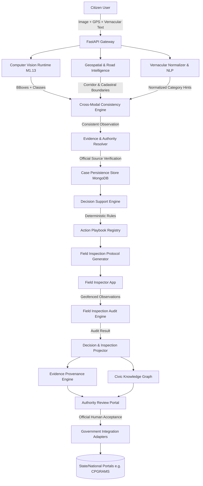

# CVKI M12.7: Final System Architecture

**Document Version**: 1.0.0 (Release Baseline M12)  
**System Name**: Civic Visual Knowledge Intelligence (CVKI)  
**Objective**: Evidence-Aware Civic Decision Support & Operational Action Intelligence

---

## 1. System Mission & Operational Boundaries

CVKI is an explainable decision-support and civic action intelligence platform. It ingests multimodal citizen reports (images, geolocation, vernacular description), extracts structured observations, resolves responsible jurisdictional authorities from verifiable sources, and produces deterministic, audited action playbooks for municipal review.

### Mandatory Architectural Boundaries
- **Decision Support, Not Autonomous Governance**: CVKI generates recommendations and draft action playbooks. It does **not** autonomously dispatch crews, execute fiscal commitments, or alter physical municipal infrastructure.
- **Human Review Mandatory**: All operational recommendations generated by CVKI enforce `human_review_required = True`.
- **Physical Verification Independence**: Statistical computer vision observations (`MODEL_OBSERVATION`) or citizen assertions (`USER_REPORTED`) do not constitute physical verification (`VERIFIED`). Resolution requires formal field inspection protocols or authorized staff sign-off.

---

## 2. High-Level Architectural Flow

---

## 3. Core Subsystem Architectures

### 3.1 Computer Vision Runtime (Module 8 & Module 1.13)
- **Model Checkpoint**: Frozen Ultralytics YOLOv8n (`yolov8n_m1_13`).
- **Cryptographic Hash**: SHA-256 `602160d4851e0d79c34cb23b828bde474fc4c164eaf1a1c2a884cfb372f4bda3`.
- **Interface Contract**: Implemented via `CVInferenceProvider` SPI. Future CV architectures (e.g. Transformers/DETR) can be plugged in without modifying API contracts or business logic.
- **Output Standards**: Bounding boxes normalized in `[0, 1]` coordinates, class names mapped to canonical taxonomy, zero leaky framework tensors.

### 3.2 Geospatial & Authority Resolution (Modules 2, 5, 6)
- **Geocoding**: OpenStreetMap/Nominatim reverse geocoding with road normalization.
- **Evidence-Backed Authority**: Disentangles `road_owner` (cadastral/statutory asset owner) from `maintenance_authority` (contracted or municipal service body) from `builder_or_contractor` (concessionaire).
- **Source Validation**: Only official government registries, tenders, or gazette documents qualify as `verified` authority sources; third-party blogs and unverified social directories are explicitly rejected.

### 3.3 Multimodal Intelligence & Active Clarification (Module 9)
- **Cross-Modal Consistency**: Computes semantic agreement between visual detections and citizen text. Inconsistencies (e.g. text describes "sewage leak" but CV detects "pothole") trigger targeted active clarification questions to the citizen.
- **Vernacular Normalization**: Rule-based multilingual normalizer mapping regional civic terminology (Hindi, Kannada, Tamil, Telugu, Marathi, Bengali, Hinglish) to canonical categories without invoking external non-deterministic LLMs.
- **Visual Resolution Auditor**: Compares before/after inspection imagery across spatial framing and defect signatures.

### 3.4 Decision Support & Action Playbooks (Module 10)
- **Playbook Registry**: Deterministic rule sets mapping defect categories, spatial urgency, and weather context to operational actions (e.g., immediate barricading, asphalt cold patch, hydro-jetting).
- **Field Inspection Protocols**: Auto-generates structured inspection checklists with geofenced location verification bounds.
- **Audit Engine**: Compares field inspector submissions against checklist standards, classifying outcomes into `SUPPORTED`, `INCONCLUSIVE`, or `CONTRADICTED`.

### 3.5 Provenance & Knowledge Graph (Modules 6 & 10)
- **Provenance Engine**: Append-only cryptographic ledger tracking every claim, algorithm, actor, and verification state with SHA-256 content hashes.
- **Civic Knowledge Graph**: Property graph linking complaints, road corridors, authorities, inspection audits, and weather events with bounded-depth traversals.

### 3.6 Government Integration Layer (Module 7)
- **Adapter Architecture**: Pluggable adapters (e.g. CPGRAMS, BBMP Sahaaya, Delhi MCD).
- **Resilience**: Exponential backoff, persistent dead-letter queue (DLQ), and idempotent dispatch tracking.
- **Status Sync**: Ingests external portal statuses without blindly overwriting CVKI local physical verification records.

---

## 4. Security & Privacy Blueprint

- **Authentication**: JWT access tokens and secure cookies.
- **RBAC**: Multi-role authorization (`CITIZEN`, `AUTHORITY`, `ADMIN`) validated server-side.
- **Privacy Obfuscation**: Citizen public map view injects 50–100m coordinate jitter to protect resident privacy.
- **Safe Network Boundary**: Strict outbound URL whitelisting; SSRF against internal subnets or cloud metadata endpoints (`169.254.169.254`) is strictly blocked.
