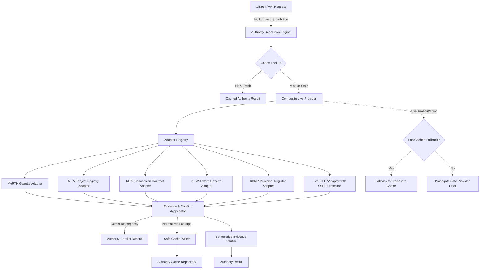

# CVKI M6.1 — Live Authority Intelligence Architecture & Implementation

## 1. Overview & Core Philosophy

Module M6.1 upgrades CVKI's evidence-driven authority intelligence from static registry lookups into a source-aware, resilient **Live Authority Intelligence** layer.

### Core Principles
- **No Fabricated Truth**: Government jurisdiction, ownership, and maintenance responsibilities are never guessed or hallucinated from geographic coordinates, administrative boundaries, or entity names.
- **Role Separation**: Road ownership (`road_owner`), maintenance responsibility (`maintenance_authority`), and concessionaire/contractor execution (`builder_or_contractor`) are strictly separated. One role never implies another.
- **Evidence Provenance & Transparency**: Every claim is traceable to an official source record with timestamp, domain, source type, and verification state.
- **Explicit Conflict Surfacing**: When official records disagree, CVKI surfaces the discrepancy explicitly rather than picking a winner arbitrarily.
- **Epistemic Caution**: Configured official sources are **not automatically proof of current real-world truth** merely because they are official; they represent documented administrative claims at a specific point in time and require explicit freshness verification.

---

## 2. System Architecture



---

## 3. Official Source Registry & Metadata

CVKI enforces a centralized, typed official source registry (`app.services.authority_registry`). Unregistered, un-allowlisted, or crowd-sourced portals are never treated as authoritative.

### Schema Fields
Each official source definition (`OfficialSourceDefinition`) maintains:
- `source_id`: Unique identifier (e.g., `src_morth_gazette`, `src_nhai_portal`).
- `organization`: Statutory body (e.g., *Ministry of Road Transport and Highways*).
- `source_name`: Descriptive publication or registry name.
- `source_type`: Formally recognized document or data format.
- `base_url`: Canonical official base URL.
- `allowed_domain`: FQDN on the government allowlist.
- `jurisdiction_scope`: `national`, `state_<state>`, or `municipal_<city>`.
- `supported_roles`: Roles the source is legally competent to verify (`road_owner`, `maintenance_authority`, `builder_or_contractor`).
- `supported_road_types`: Class of roads covered (`national_highway`, `expressway`, `state_highway`, `arterial`, `ward_road`).
- `refresh_policy_days`: Number of days evidence remains fresh before requiring re-verification.
- `active`: Boolean activation status.
- `last_verified_at`: UTC timestamp of last verified source connectivity/schema sync.

### Permitted Official Source Types
- `official_government_page`
- `official_open_data`
- `official_api`
- `official_project_registry`
- `official_tender`
- `official_contract`
- `official_concession_document`
- Legacy compatibility: `official_gazette`, `municipal_registry`, `public_works_record`, `government_portal`.

**Strictly Disallowed**: Blogs, social media platforms, Wikipedia, crowd-sourced wikis, unverified commercial directories, user forums.

---

## 4. Freshness Policy & Safe Cache Management

Freshness is treated as an explicit, policy-governed dimension rather than a fabricated confidence score.

### Freshness States
1. **Fresh (`fresh`)**: Evidence retrieved within the source's configured `refresh_policy_days` (default 30 days; statutory gazettes up to 90–180 days).
2. **Stale (`stale`)**: Evidence older than the refresh policy. Stale evidence is **never claimed to be false**; rather, it is flagged as requiring administrative re-verification. Expired cache entries never silently become "verified fresh".
3. **Unknown (`unknown`)**: Applied when retrieval metadata or refresh policy is unavailable.

### Cache State Taxonomy
Lookups are classified under one of five operational statuses:
- `live`: Retrieved successfully in real-time from active official adapters.
- `cached_fresh`: Retrieved from deterministic cache within valid TTL and refresh policy.
- `cached_stale`: Fallback to cached record whose freshness policy has expired, triggered when live providers are temporarily unreachable.
- `unavailable`: Live source failed or timed out and no cached fallback exists.
- `not_found`: Location or road has no registered official record across any adapter.
- `conflict`: Multiple official sources return contradictory authority information.

---

## 5. Live Source Adapter Architecture

The system decouples data acquisition from authority resolution via the `AuthoritySourceAdapter` interface:

```python
class AuthoritySourceAdapter(ABC):
    @property
    @abstractmethod
    def source_id(self) -> str: ...

    @abstractmethod
    def can_handle(self, *, latitude: float, longitude: float, context: dict[str, str | None]) -> bool: ...

    @abstractmethod
    def fetch_lookup(self, *, latitude: float, longitude: float, context: dict[str, str | None]) -> AuthorityLookup | None: ...
```

### Representative Adapters Implemented
1. **`MoRTHStatutoryGazetteAdapter` (`src_morth_gazette`)**:
   - Matches: National Highways and Expressways (`NH-44`, `NH-48`, etc.).
   - Resolves: Road ownership vested in the Central Government under Section 4 of the National Highways Act, 1956.
2. **`NHAIProjectRegistryAdapter` (`src_nhai_portal`)**:
   - Matches: National Highways and Expressways.
   - Resolves: Operational maintenance authority assigned to NHAI Project Implementation Units.
3. **`NHAIContractRegistryAdapter` (`src_nhai_contract_registry`)**:
   - Matches: Corridors with active concession or Build-Operate-Transfer agreements.
   - Resolves: Builder / concessionaire contractor (e.g., Bangalore Elevated Tollway Pvt Ltd for NH-44 Hosur Road Elevated Expressway).
4. **`KPWDStateGazetteAdapter` (`src_kpwd_gazette`)**:
   - Matches: Karnataka State Highways (`SH-39`, etc.) and Major District Roads.
   - Resolves: State ownership vested in Karnataka Public Works Department; divisional maintenance remains unassigned (`partially_verified`).
5. **`BBMPMunicipalRegistryAdapter` (`src_bbmp_registry`)**:
   - Matches: Bengaluru municipal arterials, sub-arterials, and ward roads (`MG Road`, `Brigade Road`, `100ft Road`).
   - Resolves: BBMP ownership and BBMP Road Infrastructure Division maintenance responsibility.
6. **`LiveHttpAuthorityAdapter`**:
   - Configurable live HTTP/JSON adapter for remote public sector APIs, equipped with pre-request SSRF validation and configurable timeouts.

---

## 6. Strict Builder / Contractor Evidence Rules

Under no circumstances does CVKI infer a builder or contractor from ownership or maintenance authority:
- Ownership by MoRTH does **NOT** imply MoRTH built the road.
- Maintenance jurisdiction by NHAI or BBMP does **NOT** imply NHAI or BBMP is the contractor.
- Free-text search results, company names, or user assertions are rejected.

**Mandatory Rule**: `builder_or_contractor` is verified **ONLY** when explicit, legally binding documentation (`official_tender`, `official_contract`, `official_concession_document`, or `official_project_registry`) is directly linked to the road corridor in the evidence trail. Otherwise, `builder_or_contractor` is set to `null` with a clear explanation in the limitations list.

---

## 7. Multi-Source Conflict Detection & Surfacing

When two official registries return conflicting claims for the same authority role (e.g., NHAI asserts central highway jurisdiction while a municipal corporation asserts municipal ownership/maintenance):
1. CVKI **refuses to arbitrarily choose** one agency over another.
2. The disputed role is set to `null` (unresolved).
3. An `AuthorityConflict` object is generated:
   - `conflicting_attribute`: Attribute in dispute (`road_owner` or `maintenance_authority`).
   - `source_a` vs `source_b`: Participating source identifiers.
   - `claim_a` vs `claim_b`: The literal competing claims.
   - `retrieved_at_a` vs `retrieved_at_b`: Retrieval timestamps.
   - `explanation`: Transparent disclosure to citizens and administrators.
4. Both pieces of evidence remain in the evidence trail for full auditability.
5. Overall verification status is set to `partially_verified` (or `not_verified`), and `source_status` is marked `conflict`.

---

## 8. Security & SSRF Protection

All outbound source URL queries and adapter configurations are protected by multi-layer SSRF safeguards (`is_safe_official_url`):
1. **URL Scheme Restrictions**: Only `http` and `https` schemes permitted.
2. **Port Restrictions**: Non-standard ports (e.g., 22, 8080, 8000) are blocked.
3. **Loopback & Private Network Blocking**: Direct IP checks block loopbacks (`127.0.0.1`, `::1`), private networks (`10.0.0.0/8`, `172.16.0.0/12`, `192.168.0.0/16`), link-local IPs, reserved ranges, and multicasts.
4. **Cloud Metadata IP Blocking**: `169.254.169.254` (AWS/GCP/Azure instance metadata service) is explicitly detected and rejected.
5. **Localhost Blocking**: `localhost`, `*.localhost`, and `localhost.localdomain` are forbidden.
6. **Government Domain Allowlist**: Hostnames must end in `.gov.in`, `.nic.in`, `.gov`, or be registered in the official trusted public sector allowlist.
7. **Client Immutability**: Clients cannot supply, override, or fabricate `verification_state`, `freshness`, or `evidence`. The server independently verifies all claims.

---

## 9. API Extensions

### 1. `GET /api/v1/authority/resolve`
Supports optional live querying via `live=true`:
```http
GET /api/v1/authority/resolve?latitude=12.91&longitude=77.63&road=NH-44&live=true
```
Response:
```json
{
  "location": {
    "latitude": 12.91,
    "longitude": 77.63,
    "road": "NH-44"
  },
  "authority": {
    "authority_status": "verified",
    "road_owner": {
      "name": "Ministry of Road Transport and Highways (MoRTH)",
      "type": "central_government_owner",
      "official_portal_url": "https://morth.nic.in"
    },
    "maintenance_authority": {
      "name": "National Highways Authority of India (NHAI)",
      "type": "public_road_authority",
      "official_portal_url": "https://nhai.gov.in"
    },
    "builder_or_contractor": {
      "name": "Bangalore Elevated Tollway Pvt Ltd",
      "type": "concessionaire_contractor"
    },
    "source_status": "live",
    "freshness": "fresh",
    "conflicts": [],
    "evidence": [...],
    "sources": [...]
  }
}
```

### 2. `GET /api/v1/authority/sources`
Lists all registered official sources with active status, allowed domains, supported road types, and refresh policies.

---

## 10. Frontend Citizen Experience

The citizen authority panel displays clear, non-overwhelming indicators:
- **Status Badges**: `Verified`, `Partially Verified`, `Not Verified`, `Conflicting Official Sources`, `Stale Evidence`, `Source Unavailable`.
- **Three Separate Roles**: Clear cards for Road Owner, Maintenance Authority, and Builder / Contractor.
- **Discrepancy Alerts**: High-visibility warning when official registries disagree on maintenance jurisdiction.
- **Collapsible Provenance**: Technical evidence records, gazette references, and official URLs are housed in an expandable `<details>` section to avoid cognitive overload.

---

## 11. Known Limitations & Future Roadmap

1. **Current Scope**: M6.1 implements representative national, state (Karnataka), and municipal (Bengaluru) adapters. Future modules can incrementally add adapters for other states (e.g., Maharashtra PWD, Delhi PWD, Tamil Nadu Highways).
2. **Government Portal Downtime**: Public government servers periodically experience outages; the safe cache and graceful fallback prevent citizen complaint submission from hanging or crashing.
3. **Statutory vs Ground Reality**: Concession contracts may change due to termination, re-tendering, or interim maintenance handovers. CVKI marks freshness explicitly and encourages user verification prior to formal complaint submission.
