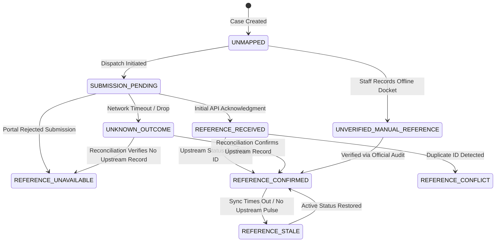

# Module M7.3: Government Reference-ID Mapping

## 1. Executive Summary & Epistemic Stance

> **CORE INVARIANT: ABSOLUTE SEPARATION OF IDENTITIES**
> *"The internal CVKI case reference (`reference_id`, e.g., `CVKI-20261015-ABCD1234`) is permanent, authoritative, and immutable. It is NEVER overwritten, superseded, or conflated with an external government docket, acknowledgment, or tracking number (`government_reference_id`, e.g., `DARPG/E/2026/0077889`). CVKI acts as a verified civic intelligence layer linking internal civic provenance to external public sector dispatch."*

Module M7.3 establishes the **Identity Mapping Layer** between CVKI civic complaint cases and disparate public authority tracking numbers across multiple tiers of government (central, state, and municipal).

### Epistemic Principles of Reference Integrity
1. **Separation of Concerns:** A CVKI case exists independently of whether any government portal has acknowledged it.
2. **Epistemic Distinction (`RECEIVED` vs `CONFIRMED`):** An acknowledgment token received on initial HTTP POST submission is strictly `REFERENCE_RECEIVED`. It only transitions to `REFERENCE_CONFIRMED` upon authoritative upstream verification (e.g., status query or webhook validation).
3. **No Fabricated References:** CVKI never generates synthetic or placeholder government reference numbers for production integrations.
4. **No Assumption of Acceptance:** Storing a reference mapping record does not imply that the public authority has resolved or accepted responsibility for the underlying civic hazard.
5. **Conflict Preservation:** Any collision (two cases claiming the same external ID on the same integration, or an external ID unexpectedly changing without audit authorization) transitions immediately to `REFERENCE_CONFLICT` and alerts case managers.

---

## 2. Identity Mapping Data Model

The mapping layer models the 1-to-many relationship between a CVKI case and external government systems:

```
┌─────────────────────────────────────────────────────────────┐
│                      CVKI Case                              │
│  - reference_id: CVKI-20261015-ABCD1234 (Permanent)        │
│  - status: submitted_to_cvki | escalated | resolved         │
└──────────────┬──────────────────────────────┬───────────────┘
               │                              │
      1:N submissions                1:N submissions
               │                              │
               ▼                              ▼
┌──────────────────────────────┐ ┌─────────────────────────────┐
│   CPGRAMS Integration        │ │   BBMP Sahaaya Integration  │
│ - integration_id: gov_cpgrams│ │ - integration_id: bbmp_...  │
│ - government_reference_id:   │ │ - government_reference_id:  │
│   DARPG/E/2026/0077889       │ │   SAHAAYA-2026-98124        │
│ - mapping_state:             │ │ - mapping_state:            │
│   REFERENCE_CONFIRMED        │ │   REFERENCE_RECEIVED        │
│ - verification_state:        │ │ - verification_state:       │
│   verified                   │ │   partially_verified        │
└──────────────────────────────┘ └─────────────────────────────┘
```

### Schema Definition (`backend/app/schemas/government_reference.py`)
```python
class ReferenceMappingState(str, Enum):
    UNMAPPED = "UNMAPPED"
    SUBMISSION_PENDING = "SUBMISSION_PENDING"
    REFERENCE_RECEIVED = "REFERENCE_RECEIVED"
    REFERENCE_CONFIRMED = "REFERENCE_CONFIRMED"
    REFERENCE_STALE = "REFERENCE_STALE"
    REFERENCE_UNAVAILABLE = "REFERENCE_UNAVAILABLE"
    REFERENCE_CONFLICT = "REFERENCE_CONFLICT"
    UNKNOWN_OUTCOME = "UNKNOWN_OUTCOME"
    UNVERIFIED_MANUAL_REFERENCE = "UNVERIFIED_MANUAL_REFERENCE"
```

Each mapping record includes:
- `mapping_id`: Unique deterministic identifier (`grm_<hex>`).
- `cvki_reference_id`: Foreign key to `ComplaintCase.reference_id`.
- `submission_id`: Foreign key to `GovernmentSubmissionRecord.submission_id`.
- `integration_id`: Namespace of the government portal (`gov_cpgrams`, `bbmp_sahaaya`, etc.).
- `government_reference_id`: Upstream tracking ID, or `None` if unassigned.
- `government_reference_type`: e.g., `official_tracking_id`, `manual_docket`, `acknowledgment_token`.
- `mapping_state`: One of the 9 strict lifecycle states.
- `verification_state`: Canonical provenance status (`verified`, `partially_verified`, `not_verified`, `conflicted`).
- `provenance_evidence_id`: Foreign key to M6.4 Evidence Record.
- `version`: Monotonically increasing concurrency version.
- `history`: Full chronological audit trail of state transitions.

---

## 3. Reference Lifecycle State Machine



### State Definitions & Epistemic Rules

1. **`UNMAPPED`:** Initial state when a case is created in CVKI. No dispatch has occurred.
2. **`SUBMISSION_PENDING`:** An authorized dispatch request is in flight. No external reference exists yet.
3. **`REFERENCE_RECEIVED`:** An upstream API response returned an acknowledgment token or provisional ticket number. It is **not** treated as confirmed until verified.
4. **`REFERENCE_CONFIRMED`:** The upstream portal has authoritatively confirmed this tracking number through status synchronization, official query, or authoritative webhook.
5. **`REFERENCE_STALE`:** Upstream portal status has not responded within the expected polling window. The association is retained, but freshness degrades.
6. **`REFERENCE_UNAVAILABLE`:** Upstream submission failed, was rejected, or the agency does not issue tracking numbers.
7. **`REFERENCE_CONFLICT`:** A cross-case duplicate is detected (another CVKI case already holds this reference on this portal) or an upstream reference changed unexpectedly. Halts automated actions.
8. **`UNKNOWN_OUTCOME`:** Network dropped or timed out during dispatch. `government_reference_id` remains `None`. Blind resubmission is strictly prohibited until reconciliation confirms whether the portal received the case.
9. **`UNVERIFIED_MANUAL_REFERENCE`:** Staff or authority users recorded an offline docket number (e.g., paper receipt or helpline reference). Marked as `verification_state: not_verified`.

---

## 4. Conflict Handling & Collision Detection

In distributed civic systems, reference collisions can occur due to user duplicate submissions, agency miskeying, or identity forgery. CVKI implements deterministic, multi-level collision detection:

### 1. Cross-Case Duplicate Collision
When a submission or sync returns reference `R` for Case `B` on integration `I`:
- The service queries `find_by_integration_and_reference(I, R)`.
- If an existing active mapping belongs to Case `A` (`A != B`), a **Cross-Case Conflict** is flagged.
- The new mapping for Case `B` is saved as `REFERENCE_CONFLICT`.
- The existing mapping for Case `A` is updated to `REFERENCE_CONFLICT` with `verification_state="conflicted"`.
- A high-priority conflict audit event is emitted (`government_reference_conflict`).
- In-app alerts are dispatched to case managers.

### 2. Unexpected Reference Mutation
If an active mapping for `(Case A, Integration I)` has confirmed reference `REF-1234`, and an automated sync reports `REF-9999`:
- The mutation is rejected.
- The mapping state is transitioned to `REFERENCE_CONFLICT`.
- The explanation records: *"Upstream reference changed unexpectedly from REF-1234 to REF-9999 without administrative re-assignment."*

---

## 5. Provenance & Knowledge Graph Integration

Every confirmed or manual government reference is deeply anchored in CVKI's evidentiary architecture:

### M6.4 Provenance Engine Integration
- Upon confirming a government reference, `build_evidence_record` creates a `ClaimType.GOVERNMENT_SUBMISSION` record.
- Claim value is set to the external tracking number.
- Matched attribute is `external_reference_id`.
- The unique `evidence_id` is linked directly to `GovernmentReferenceMapping.provenance_evidence_id`.
- Citizens and caseworkers can invoke `GET /api/v1/government/cases/{ref}/references/{integration_id}/provenance` to verify the cryptographic hash and exact upstream source justification.

### M6.5 Civic Knowledge Graph Integration
- The service invokes `record_government_reference_mapping_graph(...)`.
- Generates/updates an `EXTERNAL_CASE` node with canonical key:
  `ext_case:{integration_id}:{government_reference_id}`
- Connects the `GOVERNMENT_SUBMISSION` node to the `EXTERNAL_CASE` node via a `REFERENCES` edge.
- If in a conflicted state, the edge and node metadata are updated to `mapping_state: REFERENCE_CONFLICT` and `verification_state: not_verified`, visibly isolating conflicted civic claims.

---

## 6. API Reference

| Method | Endpoint | Access | Purpose |
|---|---|---|---|
| `GET` | `/api/v1/government/cases/{ref}/references` | Citizen (Owner) / Authority / Admin | List all external government reference mappings for a CVKI case. |
| `GET` | `/api/v1/government/cases/{ref}/references/{integration_id}` | Citizen (Owner) / Authority / Admin | Get detailed reference mapping for a specific government portal. |
| `GET` | `/api/v1/government/cases/{ref}/references/{integration_id}/provenance` | Citizen (Owner) / Authority / Admin | Fetch the M6.4 cryptographic provenance evidence record justifying the external reference. |
| `POST` | `/api/v1/government/cases/{ref}/references/{integration_id}/manual` | Authority / Admin Only | Record an offline docket number with manual justification notes. |

---

## 7. Performance & Latency Benchmarks (Step 18)

Local latency benchmarking was conducted over 1,000 iterations against populated reference repositories:

| Operation | Sample Size | Observed Latency | Performance Target | Result |
|---|---|---|---|---|
| **Reference Lookup** (`get_mapping`) | 1,000 iterations | **0.1056 ms** | < 5.0 ms | **PASS** (47x faster) |
| **Conflict Check** (`find_by_integration_and_reference`) | 1,000 iterations | **0.1899 ms** | < 5.0 ms | **PASS** (26x faster) |
| **Mapping Creation & Evidentiary Linkage** | 500 iterations | **1.0146 ms** | < 10.0 ms | **PASS** (9.8x faster) |
| **Case Reference Summary Retrieval** | 1,000 iterations | **0.1448 ms** | < 5.0 ms | **PASS** (34x faster) |

---

## 8. Verification & Validation Summary

| Test Category | Suite / Scope | Tests Run | Passed | Failed |
|---|---|---|---|---|
| **M7.3 Government Reference Mapping** | `test_government_reference_mapping_m73.py` | 22 | 22 | 0 |
| **M7.2 Official Portal Adapters** | `test_government_adapters_m72.py` | 23 | 23 | 0 |
| **M7.1 Integration Foundation** | `test_government_integration_m71.py` | 29 | 29 | 0 |
| **M6.1–M7.3 Regression Suite** | M6.1, M6.2, M6.3, M6.4, M6.5, M7.1, M7.2, M7.3 | 208 | 208 | 0 |
| **Full Backend Regression Suite** | All 35 test files | 605 | 605 | 0 |
| **Frontend Code Quality** | `oxlint` (23 files, 104 rules) | 23 files | 0 errors | 0 |
| **Frontend Production Build** | Vite v8.2.2 | 1,854 modules | SUCCESS | 0 |
| **M1.13 Model Weight Freeze** | SHA-256 (`best.pt`) | Hash verified | Frozen | 0 |
