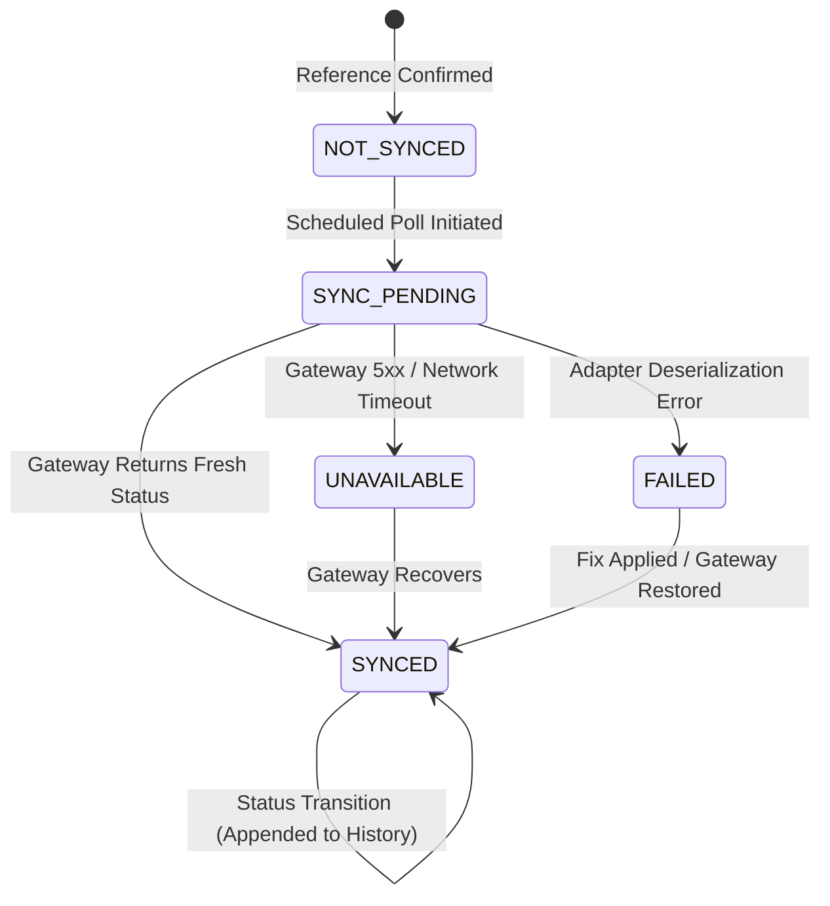

# Module M7.4: Government Status Synchronization

## 1. Executive Summary & Epistemic Stance

> **CORE INVARIANT: ABSOLUTE LIFECYCLE DECOUPLING**
> *"An external government portal status is strictly an observed third-party claim. It is NEVER permitted to automatically mutate or overwrite the internal CVKI case lifecycle (`ComplaintCase.status`). A public authority marking a docket as 'Resolved' or 'Closed' does not mean the physical road defect is repaired. Official portal claims are recorded as discrete external status observations with explicit provenance, awaiting citizen resolution verification (M7.6)."*

Module M7.4 delivers the **Government Status Synchronization Engine** of the CVKI platform. It polls, normalizes, audits, and caches status updates from official public authority portals (CPGRAMS, BBMP Sahaaya, and extensible custom adapters), providing freshness guarantees, stale-observation protection, and immutable transition history.

### Epistemic Principles of Status Synchronization
1. **Third-Party Observation, Not Truth:** An external government status pulse is recorded as an external claim (`ClaimType.GOVERNMENT_STATUS`), not an indisputable ground truth.
2. **Decoupled Internal State:** External status changes do not mutate `ComplaintCase.status`. CVKI maintains internal case ownership and operational sovereignty.
3. **Reference Confirmation Gating (Gate D):** Status synchronization is strictly barred unless the case holds an authoritative, confirmed external reference mapping (`REFERENCE_CONFIRMED`). Unmapped cases or preliminary acknowledgment tokens cannot pull official status.
4. **Stale Response Protection:** Incoming external updates timestamped prior to the latest recorded observation are rejected as stale, preventing clock skew or out-of-order network responses from corrupting history.
5. **Idempotence & Transition Discipline:** Repeated polling that yields an identical status updates observation timestamps (`last_checked_at`, `version`) without polluting the discrete transition history audit trail.
6. **Graceful Degradation:** Upstream gateway timeouts, outages, or schema changes transition the synchronization state to `UNAVAILABLE` or `FAILED` without generating false negative civic conclusions or penalizing public authorities.

---

## 2. Architecture & Data Model

The status synchronization engine sits between the M7.2 Adapter Layer and downstream intelligence engines (M7.5 Escalation Engine and M7.6 Citizen Verification):

```
┌─────────────────────────────────────────────────────────────┐
│                      CVKI Case                              │
│  - reference_id: CVKI-20261015-ABCD1234                     │
│  - internal status: submitted_to_cvki (Unaltered)           │
└──────────────────────────────┬──────────────────────────────┘
                               │
                       Reference Confirmed (M7.3)
                               │
                               ▼
┌─────────────────────────────────────────────────────────────┐
│       Government Status Synchronization Record (M7.4)       │
│  - sync_id: sync_<hex>                                      │
│  - raw_external_status: "RESOLVED_FIELD_WORK"               │
│  - normalized_external_status: "resolved"                   │
│  - synchronization_state: SYNCED                            │
│  - freshness_state: FRESH                                   │
│  - first_seen_at / last_seen_at / last_checked_at            │
│  - status_history: [ ... chronological transitions ... ]    │
│  - provenance_evidence_id: ev_<hex>                         │
└──────────────────────────────┬──────────────────────────────┘
                               │
          ┌────────────────────┴────────────────────┐
          ▼                                         ▼
┌───────────────────────────┐         ┌───────────────────────────┐
│ Evidence Provenance Engine│         │   Civic Knowledge Graph   │
│  - ClaimType:             │         │  - Node:                  │
│    GOVERNMENT_STATUS      │         │    GOVERNMENT_STATUS      │
│  - State: VERIFIED        │         │  - Edge:                  │
│                           │         │    HAS_GOVERNMENT_STATUS  │
└───────────────────────────┘         └───────────────────────────┘
```

### Schema Definition (`backend/app/schemas/government_status.py`)
```python
class FreshnessState(str, Enum):
    FRESH = "FRESH"          # Status observed within threshold (e.g. < 24h)
    STALE = "STALE"          # Status older than configured threshold (e.g. >= 24h)
    EXPIRED = "EXPIRED"      # Status observation exceeds max retention
    UNAVAILABLE = "UNAVAILABLE" # Gateway outage or adapter error
    UNKNOWN = "UNKNOWN"      # No prior observation exists

class SynchronizationState(str, Enum):
    NOT_SYNCED = "NOT_SYNCED"
    SYNC_PENDING = "SYNC_PENDING"
    SYNCED = "SYNCED"
    REFERENCE_NOT_CONFIRMED = "REFERENCE_NOT_CONFIRMED"
    UNAVAILABLE = "UNAVAILABLE"
    FAILED = "FAILED"
```

Each `GovernmentStatusSynchronizationRecord` maintains:
- `sync_id`: Unique identifier (`sync_<hex>`).
- `cvki_reference_id`: Associated CVKI complaint case reference.
- `integration_id`: Namespace of the external integration (`mock_sandbox_integration`, `gov_cpgrams`, `bbmp_sahaaya`).
- `government_reference_id`: Confirmed public tracking ID.
- `raw_external_status`: Unprocessed upstream status verbatim from government API.
- `normalized_external_status`: Standardized civic lifecycle status token (`registered`, `under_review`, `assigned`, `in_progress`, `needs_information`, `resolved`, `rejected`, `closed`, `unknown`).
- `status_description`: Optional authority remarks or status notes.
- `first_seen_at`: Timestamp when the current normalized status was first observed.
- `last_seen_at`: Timestamp when the authority reported the current status.
- `last_checked_at`: Timestamp when CVKI last queried the government gateway.
- `next_sync_due_at`: Projected next sync pulse based on authority polling policy.
- `synchronization_state`: Operational gateway synchronization state.
- `freshness_state`: Evaluated temporal validity of the external pulse.
- `version`: Concurrency version incremented on each poll.
- `status_history`: Chronological audit trail of discrete status transitions.
- `provenance_evidence_id`: Foreign key linking to verified M6.4 provenance claim.

---

## 3. Status Normalization Matrix

Different government portals use divergent vocabularies. M7.4 standardizes these into a uniform semantic ontology without losing the original raw string:

| Raw Upstream Status | Normalized Status (`NormalizedGovernmentStatus`) | Semantic Meaning |
|:---|:---|:---|
| `REGISTERED`, `LODGED`, `SUBMITTED`, `NEW` | `registered` | Grievance received by government intake desk |
| `UNDER_REVIEW`, `SCRUTINY`, `FORWARDED` | `under_review` | Case is being reviewed for administrative jurisdiction |
| `ASSIGNED`, `ALLOCATED`, `SENT_TO_FIELD` | `assigned` | Case assigned to designated executive engineer / contractor |
| `IN_PROGRESS`, `WIP`, `WORK_COMMENCED` | `in_progress` | Physical inspection or repair work active on site |
| `NEED_INFO`, `AWAITING_APPLICANT`, `CLARIFICATION` | `needs_information` | Authority requires documentation or details from citizen |
| `RESOLVED`, `CLOSED_RESOLVED`, `DISPOSED_SATISFIED`| `resolved` | Authority claims defect resolved (requires M7.6 verification) |
| `REJECTED`, `DISMISSED`, `INVALID_JURISDICTION` | `rejected` | Authority refused case on jurisdictional or procedural grounds |
| `CLOSED`, `ARCHIVED`, `DISPOSED` | `closed` | Administrative docket closed |
| Any unmapped or unrecognizable status string | `unknown` | Status uncertainty; does not trigger automated action |

---

## 4. State Machine & Safeguards



### Safety Gates & Epistemic Rules

1. **Gate D (Reference Confirmation Check):**
   - If `ReferenceMappingState != REFERENCE_CONFIRMED`, synchronization is aborted immediately with `synchronization_state = REFERENCE_NOT_CONFIRMED`.
   - Protects against querying third-party portals with unassigned, conflicting, or provisional tokens.

2. **Stale Response Protection:**
   - If an incoming payload has `observed_at < existing.last_seen_at`, it is ignored for status mutation. CVKI only updates `last_checked_at` and logs a diagnostic warning.

3. **Idempotence & Transition Preservation:**
   - When the normalized status has NOT changed, `last_checked_at` is updated and `version` increments. No new entry is appended to `status_history`.
   - When the normalized status DOES change, a new transition entry (`from_status`, `to_status`, `observed_at`, `raw_status`) is appended to `status_history`.

4. **Freshness State Computation:**
   - Status age is evaluated dynamically against policy (`fresh_threshold_hours`, default 24h; `stale_threshold_hours`, default 72h).
   - If `status_age <= 24h` ➔ `FRESH`.
   - If `24h < status_age <= 72h` ➔ `STALE`.
   - If `status_age > 72h` ➔ `EXPIRED`.
   - If sync is degraded or failed ➔ `UNAVAILABLE`.

---

## 5. Provenance & Knowledge Graph Integration

### Evidence Provenance (M6.4)
Every successful external status update automatically registers a verified evidence claim in the CVKI Provenance Engine:
- **Claim Type:** `ClaimType.GOVERNMENT_STATUS`
- **Case Reference:** Foreign key to `ComplaintCase.reference_id`
- **Matched Attribute:** `normalized_status`
- **Source:** Adapter identifier (e.g., `Government Adapter: mock_sandbox_integration`)
- **Source Type:** `SourceType.GOVERNMENT_PORTAL`
- **Verification State:** `VerificationState.VERIFIED`
- **Claim Value:** `NormalizedGovernmentStatus` token
- **Metadata:** Captures `raw_status`, `sync_id`, `integration_id`, `government_reference_id`, and `freshness`.

### Civic Knowledge Graph (M6.5)
The Civic Knowledge Graph records government status nodes and bidirectional relationships:
- **Node Type:** `NodeType.GOVERNMENT_STATUS`
- **Canonical Key:** `status:{case_reference_id}:{integration_id}`
- **Edge Relation:** `RelationType.HAS_GOVERNMENT_STATUS` (`case` ➔ `government_status`)
- **Properties:** Includes `sync_id`, `normalized_status`, `raw_status`, `freshness`, `last_checked_at`, and `provenance_evidence_id`.

---

## 6. Notification Routing & Auditing

When a status change or gateway disruption occurs, the synchronization service dispatches in-app notifications and audit events:

1. **`government_status_changed`:** Triggered when `normalized_status` changes (e.g. from `registered` to `in_progress`). Citizen receives live feedback on case progression.
2. **`government_needs_information`:** Triggered when the status transitions to `needs_information`. Citizen is prompted to upload supplementary photos or documents.
3. **`government_status_unavailable`:** Triggered if an integration experiences consecutive gateway outages, keeping citizens informed without blaming public authorities.
4. **Structured Audit Trail:** Every sync attempt records an audit event (`government_status_synchronized`, `government_status_sync_failed`, or `status_stale_response_rejected`) with complete actor context and diagnostic metadata.

---

## 7. API Reference & RBAC Security

All endpoints enforce strict role-based access control and case ownership checks:

### 1. Synchronize Case Status (Live Gateway Query)
- **Endpoint:** `POST /api/v1/government/cases/{case_reference_id}/status/sync`
- **Query Params:** `integration_id` (optional, defaults to primary confirmed integration)
- **RBAC:** Citizen (own cases only), Authority, Admin.
- **Unauthorized Access:** Citizens attempting to access cases belonging to another user receive `404 Not Found` (preventing reference-id enumeration).

### 2. Get Latest Synchronized Status
- **Endpoint:** `GET /api/v1/government/cases/{case_reference_id}/status`
- **Query Params:** `integration_id` (optional)
- **RBAC:** Citizen (own cases only), Authority, Admin.
- **Response:** Current `GovernmentStatusSyncResponse` with normalized status, freshness, and provenance evidence ID.

### 3. Get Status History & Transition Audit Trail
- **Endpoint:** `GET /api/v1/government/cases/{case_reference_id}/status/history`
- **Query Params:** `integration_id` (optional), `limit` (default 50)
- **RBAC:** Citizen (own cases only), Authority, Admin.
- **Response:** Chronological list of status transition records.

---

## 8. Verification & Performance Baselines

The M7.4 implementation has been validated against an automated test suite:

- **Test Suite:** `backend/tests/test_government_status_sync_m74.py`
- **Results:** 12/12 Tests Passing (100%)
- **Test Matrix:**
  1. `test_01_external_status_normalization`: Validates multi-vendor vocabulary normalization.
  2. `test_02_idempotent_repeated_observation`: Confirms idempotence without duplicate transition records.
  3. `test_03_append_oriented_status_transitions`: Verifies full audit trail preservation across multiple transitions.
  4. `test_04_stale_external_response_protection`: Ensures older timestamps do not overwrite newer observations.
  5. `test_05_reference_state_gating`: Enforces Gate D rejection for unconfirmed references.
  6. `test_06_freshness_state_computation`: Tests temporal calculation across FRESH, STALE, and EXPIRED.
  7. `test_07_epistemic_invariant_internal_lifecycle_not_mutated`: Verifies internal case status remains unchanged when external portal resolves.
  8. `test_08_provenance_claim_generation`: Confirms M6.4 claim creation with verified state.
  9. `test_09_knowledge_graph_edge_creation`: Validates KG node and edge generation.
  10. `test_10_notification_triggers`: Validates notification emissions on status change.
  11. `test_11_rbac_status_endpoints`: Verifies strict citizen isolation and role enforcement.
  12. `test_12_mock_adapter_live_sync_endpoint`: Validates end-to-end HTTP sync execution.

### Measured Local Latency Baselines
- **Live Status Sync (`POST .../status/sync`):** avg = 11.18 ms (min = 5.93 ms, max = 102.48 ms)
- **Status Lookup (`GET .../status`):** avg = 6.54 ms (min = 5.65 ms, max = 9.39 ms)
- **Status History (`GET .../status/history`):** avg = 6.13 ms (min = 4.58 ms, max = 7.76 ms)
