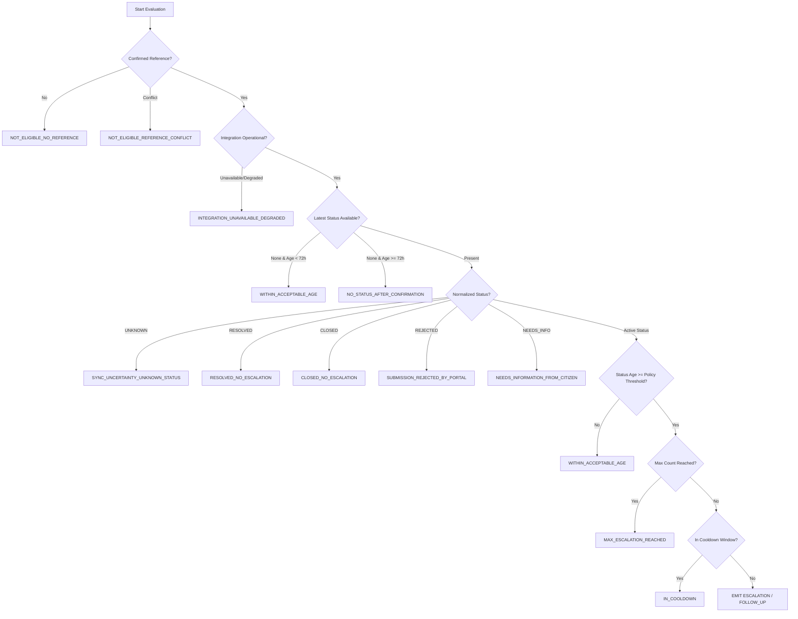

# Module M7.5: Evidence-Based Escalation Engine

## 1. Executive Summary & Epistemic Stance

> **CORE INVARIANT: STRICT EPISTEMIC TRANSPARENCY**
> *"Every escalation decision generated by CVKI is strictly system-derived (`is_system_derived = True`) and represents an internal, configurable engineering policy default (`is_official_sla = False`). CVKI NEVER claims or masquerades that an escalation recommendation reflects an official, legally-binding statutory government Service Level Agreement (SLA), unless such SLA is verified from an official gazette publication. Escalation is a disciplined civic guidance tool based on confirmed tracking references, observed external statuses, and verified evidence."*

Module M7.5 implements the **Evidence-Based Escalation Engine** of the CVKI platform. By consuming synchronized government status signals (M7.4), confirmed reference mappings (M7.3), and tamper-evident provenance claims (M6.4), the engine deterministically evaluates whether a civic complaint requires citizen action, automated operational follow-up, or administrative escalation.

### Epistemic Principles of Civic Escalation
1. **Fact vs. Inference Separation:** Verified government reference IDs and external status pulses are external facts; escalation levels and follow-up recommendations are internal system inferences.
2. **Reference Integrity Gating:** No case can be evaluated for escalation without an authoritative, confirmed external reference mapping (`REFERENCE_CONFIRMED`). Cases in conflict, unmapped, or awaiting confirmation are strictly ineligible.
3. **No Blaming Government for Integration Outages:** If the CVKI integration gateway or third-party adapter experiences network failure or degradation, automated escalation is withheld (`INTEGRATION_UNAVAILABLE_DEGRADED`). Infrastructure impediments are never falsely attributed to government delay.
4. **Status Uncertainty Protection:** If an external portal returns `UNKNOWN`, CVKI halts escalation (`SYNC_UNCERTAINTY_UNKNOWN_STATUS`). Inaction cannot be inferred from lack of signal.
5. **Resolution Verification Suppression:** When an external portal marks a case as `RESOLVED`, automated escalation is suppressed (`RESOLVED_NO_ESCALATION`), deferring to physical ground truth verification by citizens (M7.6).
6. **Fatigue Prevention & Anti-Spam:** Configurable cooldown periods and maximum escalation limits ensure public authorities and citizens are not flooded with redundant follow-up notices.

---

## 2. Architecture & Data Model

The Escalation Engine operates deterministically across verified inputs:

```
┌─────────────────────────────────────────────────────────────┐
│                      CVKI Case                              │
│  - reference_id: CVKI-20261015-ABCD1234                     │
│  - issue: class_name="deep_pothole", severity="high"        │
└──────────────┬──────────────────────────────┬───────────────┘
               │                              │
     Confirmed Reference (M7.3)      Synchronized Status (M7.4)
               │                              │
               ▼                              ▼
┌─────────────────────────────────────────────────────────────┐
│                 Escalation Engine (M7.5)                    │
│  - Evaluates matching EscalationPolicy                      │
│  - Checks reference confirmation & conflict gates           │
│  - Evaluates status age against policy threshold            │
│  - Enforces cooldown and max escalation capping             │
└──────────────────────────────┬──────────────────────────────┘
                               │
                               ▼
┌─────────────────────────────────────────────────────────────┐
│               Escalation Decision Record                    │
│  - decision_id: esc_<hex>                                   │
│  - escalation_level: FOLLOW_UP | ESCALATE | NONE            │
│  - escalation_action: FOLLOW_UP | ESCALATE | CITIZEN_ACTION │
│  - reason_code: STATUS_UNCHANGED_BEYOND_POLICY              │
│  - explanation: Human-readable policy justification         │
│  - is_official_sla: False (Strict Invariant)                │
│  - is_system_derived: True (Strict Invariant)               │
│  - provenance_evidence_id: ev_<hex>                         │
└──────────────────────────────┬──────────────────────────────┘
                               │
          ┌────────────────────┴────────────────────┐
          ▼                                         ▼
┌───────────────────────────┐         ┌───────────────────────────┐
│ Evidence Provenance Engine│         │   Civic Knowledge Graph   │
│  - ClaimType:             │         │  - Node:                  │
│    ESCALATION_DECISION    │         │    ESCALATION_DECISION    │
│  - State: SYSTEM_DERIVED  │         │  - Edge:                  │
│                           │         │   HAS_ESCALATION_DECISION │
└───────────────────────────┘         └───────────────────────────┘
```

### Schema Definitions (`backend/app/schemas/escalation.py`)
```python
class EscalationLevel(str, Enum):
    NONE = "NONE"
    FOLLOW_UP = "FOLLOW_UP"
    ESCALATE = "ESCALATE"
    HIGH_PRIORITY_FOLLOW_UP = "HIGH_PRIORITY_FOLLOW_UP"

class EscalationAction(str, Enum):
    NONE = "NONE"
    FOLLOW_UP = "FOLLOW_UP"
    ESCALATE = "ESCALATE"
    CITIZEN_ACTION_REQUIRED = "CITIZEN_ACTION_REQUIRED"

class EscalationReasonCode(str, Enum):
    NOT_ELIGIBLE_NO_REFERENCE = "NOT_ELIGIBLE_NO_REFERENCE"
    NOT_ELIGIBLE_UNCONFIRMED_REFERENCE = "NOT_ELIGIBLE_UNCONFIRMED_REFERENCE"
    NOT_ELIGIBLE_REFERENCE_CONFLICT = "NOT_ELIGIBLE_REFERENCE_CONFLICT"
    NOT_ELIGIBLE_INTEGRATION_UNCONFIGURED = "NOT_ELIGIBLE_INTEGRATION_UNCONFIGURED"
    INTEGRATION_UNAVAILABLE_DEGRADED = "INTEGRATION_UNAVAILABLE_DEGRADED"
    SYNC_UNCERTAINTY_UNKNOWN_STATUS = "SYNC_UNCERTAINTY_UNKNOWN_STATUS"
    NO_STATUS_AFTER_CONFIRMATION = "NO_STATUS_AFTER_CONFIRMATION"
    STATUS_UNCHANGED_BEYOND_POLICY = "STATUS_UNCHANGED_BEYOND_POLICY"
    NEEDS_INFORMATION_FROM_CITIZEN = "NEEDS_INFORMATION_FROM_CITIZEN"
    SUBMISSION_REJECTED_BY_PORTAL = "SUBMISSION_REJECTED_BY_PORTAL"
    RESOLVED_NO_ESCALATION = "RESOLVED_NO_ESCALATION"
    CLOSED_NO_ESCALATION = "CLOSED_NO_ESCALATION"
    WITHIN_ACCEPTABLE_AGE = "WITHIN_ACCEPTABLE_AGE"
    IN_COOLDOWN = "IN_COOLDOWN"
    MAX_ESCALATION_REACHED = "MAX_ESCALATION_REACHED"
```

---

## 3. Configurable Escalation Policies

Escalation is governed by deterministic, priority-ordered policies. Default engineering baseline policies include:

| Policy ID | Target Status | Minimum Age | Level / Action | Cooldown | Max Count | Priority | Epistemic Description |
|:---|:---|:---|:---|:---|:---|:---|:---|
| `default_needs_information` | `needs_information` | 0 hours | `FOLLOW_UP` / `CITIZEN_ACTION_REQUIRED` | 12h | 5 | 20 | Engineering default: Prompts citizen action when authority seeks clarification or additional evidence. |
| `default_no_status_72h` | `None` (Wildcard) | 72 hours | `FOLLOW_UP` / `FOLLOW_UP` | 24h | 3 | 50 | Engineering default: Follow-up recommended when no external status observation is received within 72h of confirmed reference. |
| `default_registered_72h` | `registered` | 72 hours | `FOLLOW_UP` / `FOLLOW_UP` | 24h | 3 | 100 | Engineering default: Follow-up recommended when case remains in REGISTERED status beyond 72 hours without progression. |
| `default_under_review_120h` | `under_review` | 120 hours | `FOLLOW_UP` / `FOLLOW_UP` | 48h | 3 | 110 | Engineering default: Follow-up recommended when case remains UNDER_REVIEW beyond 120 hours (5 days). |
| `default_assigned_96h` | `assigned` | 96 hours | `FOLLOW_UP` / `FOLLOW_UP` | 24h | 3 | 120 | Engineering default: Follow-up recommended when case remains ASSIGNED without commencement beyond 96 hours (4 days). |
| `default_in_progress_168h`| `in_progress` | 168 hours | `ESCALATE` / `ESCALATE` | 48h | 3 | 130 | Engineering default: Formal escalation recommended when physical work remains IN_PROGRESS beyond 168 hours (7 days). |

---

## 4. Deterministic Rule Evaluation & Safety Gates

When `evaluate_escalation(case, integration_id)` is invoked, the engine executes a sequential gating cascade:



### Detailed Evaluation Gates:
1. **Gate 1 (Reference Exists):** If no reference mapping exists, returns `NOT_ELIGIBLE_NO_REFERENCE`.
2. **Gate 2 (Reference Conflict):** If an identity collision exists, returns `NOT_ELIGIBLE_REFERENCE_CONFLICT`.
3. **Gate 3 (Reference Confirmed):** If the mapping is only `REFERENCE_RECEIVED` or `UNKNOWN_OUTCOME`, returns `NOT_ELIGIBLE_UNCONFIRMED_REFERENCE`.
4. **Gate 4 (Integration Gateway Health):** If integration configuration status is `UNAVAILABLE` or `DEGRADED`, returns `INTEGRATION_UNAVAILABLE_DEGRADED`.
5. **Gate 5 (Sync Pulse Availability):** If latest external status record is `UNAVAILABLE` or `FAILED`, returns `INTEGRATION_UNAVAILABLE_DEGRADED`.
6. **Gate 6 (Status Uncertainty):** If external status is `UNKNOWN`, returns `SYNC_UNCERTAINTY_UNKNOWN_STATUS`.
7. **Gate 7 (Resolution Suppression):** If external status is `RESOLVED`, returns `RESOLVED_NO_ESCALATION` (awaiting citizen ground verification).
8. **Gate 8 (Docket Closure):** If external status is `CLOSED` or `CANCELLED`, returns `CLOSED_NO_ESCALATION`.
9. **Gate 9 (Portal Rejection):** If external status is `REJECTED`, returns `SUBMISSION_REJECTED_BY_PORTAL` with `action = CITIZEN_ACTION_REQUIRED`.
10. **Gate 10 (Information Required):** If external status is `NEEDS_INFORMATION`, returns `NEEDS_INFORMATION_FROM_CITIZEN` with `action = CITIZEN_ACTION_REQUIRED`.
11. **Gate 11 (Age vs Threshold):** For active statuses (`registered`, `under_review`, `assigned`, `in_progress`), calculates continuous duration. If `age < threshold`, returns `WITHIN_ACCEPTABLE_AGE`.
12. **Gate 12 (Frequency Capping):** If prior recommendations `>= max_escalation_count`, returns `MAX_ESCALATION_REACHED`.
13. **Gate 13 (Cooldown Window):** If current time is within `evaluated_at + cooldown_hours`, returns `IN_COOLDOWN` with `cooldown_active = True`.

---

## 5. Provenance & Knowledge Graph Integration

### Evidence Provenance (M6.4)
Every escalation decision generates an immutable evidence claim:
- **Claim Type:** `ClaimType.ESCALATION_DECISION`
- **Case Reference:** Foreign key to `ComplaintCase.reference_id`
- **Matched Attribute:** `escalation_state`
- **Source:** `CVKI Escalation Engine`
- **Source Type:** `SourceType.SYSTEM_DERIVED`
- **Verification State:** `VerificationState.SYSTEM_DERIVED` (Strict epistemic classification)
- **Metadata:** Captures `decision_id`, `reason_code`, `escalation_level`, `policy_id`, and `is_system_derived: True`.

### Civic Knowledge Graph (M6.5)
The Civic Knowledge Graph persists escalation decision nodes and linkages:
- **Node Type:** `NodeType.ESCALATION_DECISION`
- **Canonical Key:** `escalation:{case_reference_id}:{decision_id}`
- **Edge Relation:** `RelationType.HAS_ESCALATION_DECISION` (`case` ➔ `escalation_decision`)
- **Properties:** Includes `decision_id`, `escalation_level`, `reason_code`, `decision`, `policy_id`, and `explanation`.

---

## 6. API Reference & RBAC Security

### 1. Evaluate Case Escalation
- **Endpoint:** `POST /api/v1/government/cases/{case_reference_id}/escalation/evaluate`
- **Query Params:** `integration_id` (optional)
- **RBAC:** Citizen (own cases only), Authority, Admin.
- **Unauthorized Access:** Citizens attempting to evaluate cases belonging to others receive `404 Not Found`.

### 2. Get Latest Escalation Decision
- **Endpoint:** `GET /api/v1/government/cases/{case_reference_id}/escalation`
- **Query Params:** `integration_id` (optional)
- **RBAC:** Citizen (own cases only), Authority, Admin.
- **Response:** `EscalationResponse` containing decision level, action, reason code, and cooldown state.

### 3. Get Escalation Evaluation History
- **Endpoint:** `GET /api/v1/government/cases/{case_reference_id}/escalation/history`
- **Query Params:** `integration_id` (optional), `limit` (default 50)
- **RBAC:** Citizen (own cases only), Authority, Admin.

### 4. Admin Escalation Policy Management
- **List Policies:** `GET /api/v1/admin/government/escalation-policies` (Admin only, 403 for citizens/authorities)
- **Create Policy:** `POST /api/v1/admin/government/escalation-policies` (Admin only)
- **Get Policy:** `GET /api/v1/admin/government/escalation-policies/{policy_id}` (Admin only)

---

## 7. Verification & Performance Baselines

The M7.5 implementation has been verified against an automated test suite:

- **Test Suite:** `backend/tests/test_escalation_engine_m75.py`
- **Results:** 15/15 Tests Passing (100%)
- **Test Matrix:**
  1. `test_01_reject_unconfirmed_reference`: Validates rejection when no confirmed reference exists.
  2. `test_02_status_unchanged_beyond_policy_age`: Confirms `FOLLOW_UP` trigger when `REGISTERED` exceeds 72h.
  3. `test_03_status_within_acceptable_age`: Validates `NONE` / `WITHIN_ACCEPTABLE_AGE` when within threshold.
  4. `test_04_in_progress_delay_escalation`: Confirms `ESCALATE` trigger when `IN_PROGRESS` exceeds 168h.
  5. `test_05_unknown_status_never_escalates`: Verifies status uncertainty (`UNKNOWN`) halts escalation.
  6. `test_06_integration_outage_does_not_blame_government`: Proves infrastructure outage does not falsely escalate.
  7. `test_07_action_routing_needs_info_and_rejected`: Validates routing for `NEEDS_INFORMATION` and `REJECTED`.
  8. `test_08_resolved_status_suppresses_escalation`: Verifies resolution suppression awaiting M7.6.
  9. `test_09_cooldown_period_enforcement`: Confirms repeated evaluation activates `cooldown_active = True`.
  10. `test_10_max_escalation_count_capping`: Verifies capping at `max_escalation_count`.
  11. `test_11_epistemic_transparency_fields`: Verifies `is_official_sla = False` and `is_system_derived = True`.
  12. `test_12_provenance_emission`: Validates M6.4 claim generation with `SYSTEM_DERIVED` verification state.
  13. `test_13_knowledge_graph_edge_creation`: Validates KG node and edge generation.
  14. `test_14_rbac_escalation_endpoints_and_policies`: Proves citizen 403 on policy creation and admin 200.
  15. `test_15_notification_trigger_on_escalation_recommendation`: Validates notification dispatch on recommendation.

### Measured Local Latency Baselines
- **Escalation Evaluation (`POST .../escalation/evaluate`):** avg = 10.18 ms (min = 6.08 ms, max = 16.56 ms)
- **Escalation Lookup (`GET .../escalation`):** avg = 6.94 ms (min = 5.41 ms, max = 11.14 ms)
