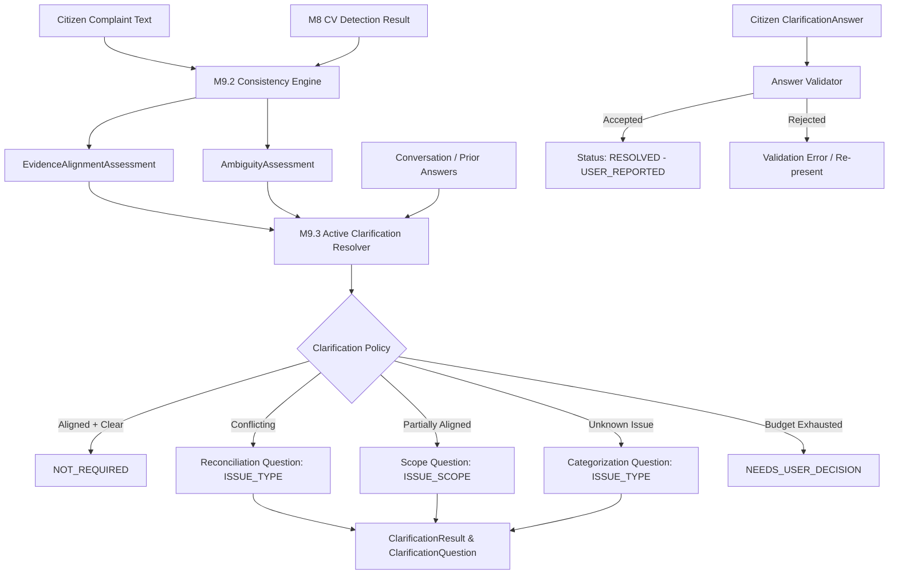

# CVKI Module 9.3 — Active Clarification & Ambiguity Resolver

## 1. Motivation & Purpose

In civic defect reporting, citizen-provided complaint text and computer vision (CV) detections frequently exhibit discrepancies, partial overlaps, or informational ambiguities:
- A citizen reports an *"open manhole"* while visual imagery shows *"waterlogging"*.
- A citizen reports *"broken road sign and waterlogging"*, but visual evidence only corroborates waterlogging.
- A citizen submits a vague claim (*"danger on the road, please repair"*) lacking defect categorization.
- A citizen description omits critical location attributes required to dispatch repair crews.

Rather than making opaque inferences, accusing citizens of misreporting, or guessing physical reality, **M9.3 Active Clarification & Ambiguity Resolver** implements a bounded, explainable, and non-leading policy engine. When M9.2 cross-modal assessments detect inconsistency or missing information, M9.3 generates targeted, citizen-friendly questions to clarify citizen intent.

> [!IMPORTANT]
> **Core Epistemic Principle:**
> M9.3 resolves ambiguity in the citizen's report; it does not verify physical ground truth.
> A clarification status of `RESOLVED` indicates that report ambiguity has been cleared by citizen response, **NOT** that the physical hazard has been verified or fixed.

---

## 2. Architecture & Pipeline Integration

M9.3 sits directly downstream of the M9.2 Cross-Modal Evidence Consistency & Grounding Engine and operates as a bounded rule-based policy engine:



### Architectural Distinctions
- **No LLM/VLM Dependency:** Completely deterministic template and policy-driven generation. Zero external API or network calls.
- **Not a Free-Form Chatbot:** Employs bounded single/multi-choice menus and strictly validated free-text fields.
- **Decoupled Inference:** Operates independently of underlying CV models (tested with M1.13 and future CV providers).

---

## 3. Clarification Policy

M9.3 applies deterministic, priority-ordered policy rules to map M9.2 signals to clarification actions:

| Alignment State | Ambiguity State | Condition | Target Field | Generated Clarification Action |
| :--- | :--- | :--- | :--- | :--- |
| `ALIGNED` | `CLEAR` | Vision and text agree completely | None | `status = NOT_REQUIRED`, `questions = []` |
| `CONFLICTING` | `CONFLICTING_EVIDENCE` | Text mentions Category A, CV detects Category B | `issue_type` | Neutral reconciliation question presenting choices A, B, Both, Something else |
| `PARTIALLY_ALIGNED` | `AMBIGUOUS` | Text mentions A + B, CV only corroborates A | `issue_scope` | Scope question asking whether A only, B only, Both, or Something else should be reported |
| `INSUFFICIENT_EVIDENCE` | `INSUFFICIENT_EVIDENCE` | No recognized civic category in citizen text | `issue_type` | Categorization question presenting standardized M1.13 civic defect categories |
| Any | `AMBIGUOUS` | Category identified but location context missing | `issue_location` | Focused free-text query requesting street name, landmark, or area |
| Any | Any | Question budget (2-3) reached without resolution | Any | `status = NEEDS_USER_DECISION`, questioning suspended |
| Any | `INSUFFICIENT_EVIDENCE` | Neither text nor visual detections present | None | `status = INSUFFICIENT_INFORMATION`, `questions = []` |

---

## 4. Question Types

M9.3 restricts question categories to a controlled enumeration (`ClarificationQuestionType`):

1. **`ISSUE_TYPE`**: Reconciles conflicting issue claims or identifies unknown civic defect classes.
2. **`ISSUE_SCOPE`**: Disambiguates multi-hazard reports where CV only corroborates a subset.
3. **`ISSUE_LOCATION`**: Captures missing road name, landmark, or geospatial reference.
4. **`ISSUE_COUNT`**: Clarifies the quantity or extent of defects (e.g. multiple potholes/manholes).
5. **`ISSUE_SEVERITY_DESCRIPTION`**: Gathers descriptive severity context without leading prompts.
6. **`VISUAL_CONDITION`**: Clarifies visual obstructions or specific defect characteristics.
7. **`TEMPORAL_CONTEXT`**: Clarifies recurrence or duration of civic hazard.
8. **`RESOLUTION_STATE`**: Clarifies citizen status inquiries regarding pre-existing reports.
9. **`OTHER`**: Controlled catch-all for auxiliary civic clarification.

---

## 5. Question Budget & Anti-Loop Safeguards

To prevent citizen fatigue and endless automated questioning:
- **Default Budget (`MAX_QUESTIONS`):** 2 questions per clarification cycle.
- **Hard Upper Cap:** 3 questions absolute maximum.
- **Deduplication:** Questions matching previously asked `question_id` or `target_field` are suppressed.
- **Budget Exhaustion:** If the report remains ambiguous after the maximum questions, M9.3 transitions to `ClarificationStatus.NEEDS_USER_DECISION` with explainable rationale rather than continuing to prompt.

---

## 6. Clarification State Machine

The clarification lifecycle transitions through deterministic states:

```
           [Input Evaluation]
                   │
         ┌─────────┴─────────┐
         ▼                   ▼
   [NOT_REQUIRED]     [CLARIFICATION_REQUIRED]
                             │
                             ▼
                    [QUESTION_PRESENTED]
                             │
                     (Citizen Responds)
                             ▼
                     [ANSWER_RECEIVED]
                             │
                     (Validation Check)
                    ┌────────┴────────┐
                    ▼                 ▼
             [ANSWER_ACCEPTED]   [REJECTED / INVALID]
                    │                 │
            ┌───────┴───────┐         ▼
            ▼               ▼   [QUESTION_PRESENTED]
        [RESOLVED]   [Budget Exceeded]
                            │
                            ▼
                  [NEEDS_USER_DECISION]
```

### Terminal States
- `NOT_REQUIRED`: Initial input is clear and corroborated.
- `RESOLVED`: Citizen clarification answered all outstanding ambiguity.
- `NEEDS_USER_DECISION`: Automated question budget reached; manual civic operator review required.
- `INSUFFICIENT_INFORMATION`: Available inputs are inadequate to formulate meaningful questions.
- `CANCELLED`: Clarification interaction dismissed.

---

## 7. Non-Leading Safeguards & Citizen-Friendly Phrasing

M9.3 strictly enforces non-leading, neutral language in all generated questions:
- **Never claim CV is ground truth:** Avoid *"CV detected waterlogging. Isn't that the actual problem?"*
- **Never accuse the citizen:** No terms like *"fraud"*, *"fake"*, *"lie"*, or *"wrong"*.
- **Never infer causality:** No statements like *"the open manhole caused the waterlogging"*.
- **Neutral Reconciliation Menus:** Both the citizen's claim and the visual observation are presented as equal options alongside *"Both"* and *"Something else"*.

Example:
> **Question:** *"Which issue best describes the problem you want to report?"*  
> **Choices:** `[ "Open/damaged manhole", "Road waterlogging", "Both", "Something else" ]`

---

## 8. Answer Validation & Sanitization

All incoming `ClarificationAnswer` objects undergo strict validation:
1. **Question Correlation:** `answer.question_id` must match the active `ClarificationQuestion`.
2. **Option Membership:** In single-choice questions, `selected_option` must belong to `question.options`.
3. **Length Bounds:** Free text is capped at 500 characters.
4. **URL & Network Links:** Rejects URLs (`http://`, `https://`, `ftp://`).
5. **Path Traversal Guards:** Rejects filesystem paths (`..`, `/etc/`, `C:\`, null bytes).
6. **Credential Filtering:** Rejects sensitive keywords (`password`, `bearer`, `jwt`, `token`, `secret`).
7. **Epistemic Constraint:** Citizen responses are strictly locked to `EpistemicState.USER_REPORTED`.

---

## 9. Epistemic Safety Boundaries

M9.3 explicitly isolates operational clarification from physical verification:
- A citizen answer is citizen testimony (`USER_REPORTED`).
- It does not verify that a physical defect exists or has been repaired.
- Downstream dispatch and civic maintenance systems must treat clarified reports as citizen claims requiring field verification, not as proven facts.

---

## 10. Language Boundary

M9.3 supports deterministic templates across three languages:
- **English (`en`):** Standard neutral civic phrasing.
- **Hindi (`hi`):** Devanagari templates (e.g. *"आप किस समस्या की रिपोर्ट करना चाहते हैं?"*).
- **Hinglish (`hinglish`):** Phonetic Romanized Hindi/English (e.g. *"Aap kis issue ki report karna chahte hain?"*).
- **Unsupported Fallback:** Any unrecognized language tag automatically and safely defaults to English templates without crashing.

> [!NOTE]
> M9.3 is **not** M9.4. It does not perform vernacular translation, phonetic dialect parsing, or multilingual entity extraction.

---

## 11. Security & PII Protection

- **Input Sanitization:** Reuses M9.1 `sanitize_text_pii` to redact phone numbers and email addresses.
- **Metadata Protection:** Sanitizes sensitive authentication tokens, passwords, and sessions.
- **No Remote Network Access:** Zero outbound socket or HTTP calls.
- **Bounded Allocations:** Maximum 3 questions per result, maximum 10 choices per question, maximum 500 characters per response.

---

## 12. Verification & Test Suite

The test suite in `backend/tests/test_active_clarification_m93.py` covers 27 comprehensive scenarios:

1. `test_01_aligned_and_clear_generates_no_question` — ALIGNED + CLEAR yields `NOT_REQUIRED`
2. `test_02_conflicting_generates_neutral_reconciliation_question` — CONFLICTING yields neutral question
3. `test_03_partially_aligned_generates_focused_scope_question` — PARTIALLY_ALIGNED yields scope question
4. `test_04_unknown_issue_generates_issue_type_question` — Unknown issue prompts `ISSUE_TYPE`
5. `test_05_insufficient_evidence_bounded_safe_response` — Insufficient evidence safely handled
6. `test_06_maximum_question_limit_enforced` — Budget cap enforced (`NEEDS_USER_DECISION`)
7. `test_07_no_duplicate_question_in_same_cycle` — Question deduplication in single cycle
8. `test_08_answered_question_not_repeated` — Answered questions not re-asked
9. `test_09_valid_option_accepted` — Valid option passed
10. `test_10_invalid_option_rejected` — Invalid option rejected
11. `test_11_free_text_length_validation` — Free text length clamped and validated
12. `test_12_user_answer_strictly_remains_user_reported` — Epistemic state clamped to `USER_REPORTED`
13. `test_13_clarification_resolved_does_not_mean_civic_issue_resolved` — Epistemic boundary preserved on resolution
14. `test_14_no_accusation_language_in_questions` — Accusation terms verified absent
15. `test_15_no_leading_questions` — Leading phrasing verified absent
16. `test_16_no_causality_claims` — Causality statements verified absent
17. `test_17_deterministic_repeated_execution` — Idempotency and consistency verified
18. `test_18_english_template` — English localization verified
19. `test_19_hindi_template` — Hindi Devanagari localization verified
20. `test_20_hinglish_template` — Hinglish localization verified
21. `test_21_unsupported_language_fallback` — Safe fallback to English for unknown languages
22. `test_22_pii_sanitization` — Phone and email redaction verified
23. `test_23_credential_and_path_sanitization_in_answers` — Security injection rejection verified
24. `test_24_no_external_network_calls` — Socket guard verifies zero network calls
25. `test_25_m92_regression_integrity` — M9.2 cross-modal engine regression passes
26. `test_26_m91_regression_integrity` — M9.1 SPI contracts regression passes
27. `test_27_model_independent_behavior` — Equivalent behavior across distinct vision providers

---

## 13. Performance Benchmarks

Measured over 100 warmup-stabilized iterations on standard local environment:

| Operation | Mean Latency | Median Latency | Min Latency | Max Latency | Sample Count |
| :--- | :--- | :--- | :--- | :--- | :--- |
| **Resolver Initialization** | 0.0002 ms | 0.0002 ms | 0.0001 ms | 0.0006 ms | 100 |
| **Clarification Generation** | 0.0294 ms | 0.0292 ms | 0.0271 ms | 0.0423 ms | 100 |
| **Answer Validation** | 0.0021 ms | 0.0021 ms | 0.0019 ms | 0.0025 ms | 100 |
| **Repeated Resolution Cycle** | 0.0511 ms | 0.0532 ms | 0.0295 ms | 0.1888 ms | 100 |

*All clarification operations complete in sub-millisecond time.*

---

## 14. Operational Limitations

1. **Rule-Bounded Categorization:** Only addresses civic hazard categories recognized by CVKI core taxonomies (`open_damaged_manhole`, `damaged_missing_road_sign`, `road_waterlogging`). Novel defect classes fall back to `OTHER_CIVIC_ISSUE`.
2. **Static Question Templates:** Uses deterministic templates; does not generate customized prose.
3. **No Automatic Ground Truth Establishment:** Citizen answers cannot promote uncorroborated claims to `VERIFIED_EVIDENCE`.

---

## 15. Hand-off & M9.4 Dependency

M9.3 is complete and self-contained. It establishes structured clarification questions and answer validation schemas ready for future integration:
- **M9.4 (Multilingual Vernacular Normalizer):** Will consume citizen answers and complaint text in Indian vernacular dialects (e.g. Bhojpuriya, Haryanvi, colloquial Hinglish) to map them into standardized English/Hindi tokens before M9.3 generates questions.
- **M9.5 (Visual Resolution Auditing):** Will evaluate post-repair before/after visual pairs.

**M9.3 implementation is COMPLETE. Awaiting user review.**
