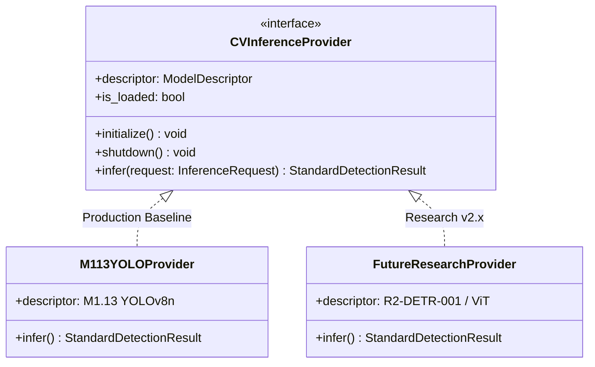

# CVKI Research v2.x: Scientific Architecture & Research Protocol

**Document Version**: 2.0.0 (Research Milestone R0)  
**System Lineage**: Post-M12 Research Architecture  
**Scope**: Experimental Methodology, Integrity Controls, and Model SPI Integration

---

## 1. Lineage & Separation of Concerns

CVKI v1 established the operational, production-ready civic decision support platform, which is permanently frozen at Milestone M12.

**CVKI Research v2.x** establishes the decoupled scientific pipeline for advanced modeling, dataset expansions, and multi-modal intelligence exploration.

```
┌────────────────────────────────────────────────────────┐
│                        CVKI v1                         │
│  - M1.13 YOLOv8n (SHA-256 locked, 605 files)           │
│  - Frozen Production Baseline                          │
│  - Multi-tier Operational Lifecycles                   │
└───────────────────────────┬────────────────────────────┘
                            │
                            ▼
┌────────────────────────────────────────────────────────┐
│                  CVKI Research v2.x                    │
│  - Hypothesis-First Scientific Methodology             │
│  - Experiment Registry (CVR2-*)                        │
│  - Dataset Registry (D0 Baseline + D1..Dn Expansions)  │
│  - Model Registry (R2-* Architecture Variants)         │
│  - Standardized Benchmark & Comparison Harness         │
│  - Independent Research Reports                        │
└────────────────────────────────────────────────────────┘
```

---

## 2. Integration with Standardized CV Provider Interface

Future computer vision models developed within CVKI Research v2.x (e.g. Vision Transformers, RT-DETR, or ensemble architectures) connect directly to the existing production system via the **`CVInferenceProvider` Service Provider Interface (SPI)** located at `backend/app/services/cv/base_provider.py`.

### Architectural Connection Pattern



### Protocol for Research Providers:
1. **Zero Downstream Mutation**: Research providers must emit `StandardDetectionResult` with bounding boxes in normalized `[0, 1]` coordinates and zero framework-specific tensor leaks.
2. **Encapsulated Checksums**: Every research provider adapter must declare its weights SHA-256 hash in its `ModelDescriptor`.
3. **Pluggable Registration**: Research providers can be registered in the backend model registry for side-by-side benchmark comparison without replacing the active production model.

---

## 3. Registries & Provenance Controls

### 3.1 Experiment Registry
Tracks every scientific inquiry with unique identifiers (`CVR2-CV-001`, `CVR2-DATA-001`). Enforces:
- Falsifiable hypotheses with explicit independent and dependent variables.
- Required random seeds to guarantee reproducible configurations.
- Immutable status state machine (`PLANNED` $\rightarrow$ `RUNNING` $\rightarrow$ `COMPLETED` / `FAILED` / `BLOCKED` $\rightarrow$ `ARCHIVED`).

### 3.2 Dataset Registry
Maintains versioned catalogs of training and benchmark corpora:
- `D0`: Frozen production baseline (`dataset_m1_13`, 605 files). Protected against edits.
- `D1..Dn`: Versioned research expansions with split definitions and composite inventory hashes.
- Train/Validation/Test split boundaries are tracked explicitly to prevent test-set contamination.

### 3.3 Model Registry
Maintains model lineage, parameter counts, input dimensions, and cryptographic weight hashes.
- `M1.13`: Immutable `FROZEN_REFERENCE`.
- Research models (`R2-YOLO-S-001`, `R2-DETR-001`) receive isolated identities and documentation.

---

## 4. Benchmark & Metrics Standard

All research evaluations report standard metrics via the `EvaluationMetrics` schema:
- **Detection Performance**: Precision, Recall, $mAP_{50}$, $mAP_{50-95}$, $F_1$, and per-class breakdowns.
- **Computational Efficiency**: Single-image inference latency (ms), throughput (FPS), peak GPU VRAM (MB), host RAM (MB).
- **Epistemic & Reliability**: False positive rate, false negative rate, calibration error (ECE), and perturbation robustness score.
- **Reporting Rule**: Metrics must explicitly cite the evaluation split (e.g., `M1.8 held-out test split` or `D0 test split`). Validation metrics must never be reported as test results.

---

## 5. Experiment Comparison Discipline

The comparison utility (`ai.research.comparison.compare_experiments`) formats cross-experiment measurements into objective, multi-column tables.

The framework strictly adheres to the scientific principle of **measurement reporting without automated winner declaration**. Human researchers must provide contextual scientific interpretation regarding trade-offs between precision, recall, parameter scale, and latency.
